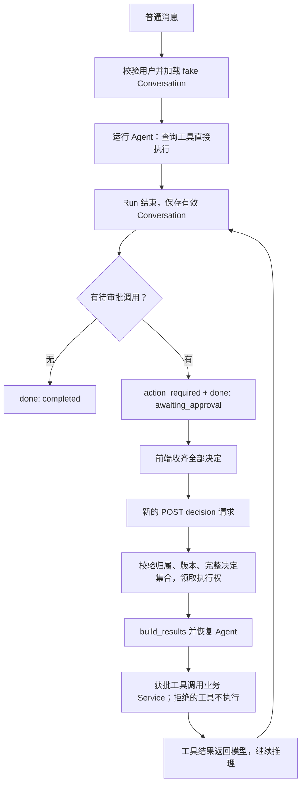

# EvalForge Assistant：Deferred Tools 审批与持久化方案

本文保留第一阶段的历史设计。当前已用数据库 ConversationStore 替换 fake，最新事件使用 approval_required 和 display，协议见 [助手 SSE 与卡片](assistant-sse.md)，恢复边界见 [评测助手](assistant.md)。以下记录第一阶段：原生审批、统一 SSE 与内存 fake Conversation 存储。工具参数见 [基础工具](assistant-tools.md)，接入说明见 [评测助手](assistant.md)。

## 1. 本阶段范围

- 使用 PydanticAI Deferred Tools 暂缓写工具，批准后由服务端恢复 Agent，执行结果脱敏后交给模型继续回答。
- 不建立 `AssistantAction` 表，不另造 `action_id` 或审批批次表。待审批调用来自 `Conversation.deferred_tool_requests.approvals`，以 `tool_call_id` 标识。
- **Conversation 存储先用异步 fake 函数和进程内字典实现，暂不改数据库表或迁移。** fake 必须实际保存、读取和恢复现场，不能只返回成功。
- 前端收齐全部批准/拒绝决定后一次提交；部分选择仅在 React 内存中，刷新后重新选择。
- 统一使用 POST + fetch 读取 SSE；等待用户审批时，本次 Run 与 SSE 都结束，不保留挂起协程。
- fake 仅替代助手 Conversation 的持久化。获批工具仍真实调用业务 Service，创建资源、启动或取消实验。

## 2. 改造前后

| 改造前 | 当前实现 |
| --- | --- |
| 写工具调用 `_propose()`，收集临时 `actions` | 写工具注册 `requires_approval=True`，工具体实现真实业务调用 |
| 工具返回 `requires_confirmation` | Run 输出 `DeferredToolRequests` 或正常文本 |
| 前端确认后直接调用业务 API | 前端只提交调用 ID 与决定，服务端恢复工具执行 |
| 结果仅显示在前端卡片 | 真实工具结果进入 Agent 上下文，模型继续回答 |
| JSON 聊天为当前网页入口，后端可选 SSE | 普通消息与审批恢复共用统一 SSE 入口 |
| 数据库保存序列化消息 | 新链路额外通过 fake 存取完整 Conversation |

网页已使用 `POST /api/v1/assistant/stream`。旧 `POST /api/v1/assistant/sessions/{id}/chat` 保留普通消息 JSON / SSE 兼容，但其审批数据也已改为原生 Deferred Tools；审批恢复统一走 `/stream`。

## 3. 执行链路



两类请求共用结果处理逻辑：保存完成后再发送正式 `action_required` 或 `done`。恢复后再次产生待审批调用，就重复此流程。

## 4. fake 存储边界

提供 `load_conversation()`、`save_conversation()` 等异步函数，由助手编排层调用；将来替换为 PostgreSQL 实现时保持调用边界。

内存记录至少包含：

| 内容 | 用途 |
| --- | --- |
| `session_id`、`user_id` | 沿用现有整数会话 ID，检查所属用户 |
| Conversation 快照 | 完整保存消息、usage、库的 conversation_id、deferred_tool_requests 等 |
| `version`、`status` | 检测过期请求；状态为 completed / running / awaiting_approval / failed |
| 恢复配置 | 暂停时的模型名称及必要上下文元数据，不保存 API Key |
| 最近错误 | 记录失败原因；保留最后一次有效 Conversation |

- 用 `ConversationTypeAdapter` 序列化和反序列化；加载返回独立副本，避免 Run 原地修改最后一个有效快照。
- 正常完成和 Deferred Tools 暂停都在 Run 结束后保存；不逐 Token、逐工具写库。
- 同一会话的读版本、领取执行权和状态更新由进程内会话级锁配合现有数据库版本及租约协调，阻止并行 Run 和重复恢复。模型执行期间仍不占用数据库事务。
- `awaiting_approval` 时不接受新普通消息。审批等待期间没有运行协程，也不需要持续占用执行锁。
- fake 是恢复现场的依据。数据库消息继续保留用于展示；版本大于 0 却找不到 fake 现场时返回 `unavailable`，历史可看但必须新建会话才能继续，不通过旧消息推测待审批操作。

**仅支持单个后端进程。** 浏览器刷新后，同一进程可恢复已保存的待审批卡片；后端重启会丢失 fake 内容。现有双实例 Compose 部署不能直接用于这条内存审批链路，粘性路由也不提供重启恢复。

## 5. 请求与响应

以下为已实现协议，均使用登录 Cookie，POST 校验 CSRF。沿用现有 `session_id`、`message`、`model_name` 和 `page_context` 概念，避免示例字符串 ID 与当前整数主键混淆。

统一入口：`POST /api/v1/assistant/stream`，响应 `text/event-stream`。

普通消息：

```json
{
  "type": "message",
  "session_id": 42,
  "expected_version": 0,
  "message": "创建一个名叫本地开发的 Runner",
  "model_name": "已配置的模型名",
  "page_context": {"type": "experiment", "id": 7}
}
```

`model_name`、`page_context` 可省略。审批恢复使用暂停时的配置，不在决策请求中修改模型、工具名或执行参数：

```json
{
  "type": "decision",
  "session_id": 42,
  "expected_version": 1,
  "decisions": {"call_001": true, "call_002": false}
}
```

决定严格为布尔值，键集合与服务端当前 `approvals` 完全一致；缺项、多项、过期版本或无待审批调用均不恢复。读取已保存 requests 后，用 `requests.build_results(approvals=...)` 和 `agent.run(conversation=..., deferred_tool_results=..., deps=...)` 执行。

| SSE 事件 | 数据与含义 |
| --- | --- |
| `text_delta` | `{"text":"..."}`，追加临时文字 |
| `tool_call` / `tool_result` | 可选的工具进度；不等于存储确认，结果必须脱敏 |
| `action_required` | `{"version":1,"actions":[{"tool_call_id":"call_001","tool":"RUNNER_create_runner","arguments":{"name":"本地开发"}}]}`，fake 保存成功后发送 |
| `done` | `{"version":1,"status":"awaiting_approval"}` 或 `{"version":2,"status":"completed"}`；只表示本次请求结束 |
| `error` | `{"code":"...","message":"..."}`；查询会话确认最新状态，不自动重放批准请求 |

会话详情 `GET /api/v1/assistant/sessions/{id}` 返回 `status`、`version`、由 fake Conversation 提取的待审批 `actions`、可展示消息、`credential_call_ids` 以及可空的 `error`；不向浏览器暴露完整内部 Conversation。fake 现场缺失时明确告知无法恢复，不根据旧消息重建并执行工具。

独立凭证交付：`POST /api/v1/assistant/sessions/{id}/runner-credentials/{tool_call_id}`，无请求体，登录 + CSRF。返回与创建 Runner 接口相同的完整创建响应（Runner、credential、connection），只允许所属用户领取一次，之后返回 `404 assistant_credential_not_found`。网络失败可能已经消费凭证，不自动重放；必要时删除并重建 Runner。

## 6. 工具与前端改造

- 保留 17 个工具的业务能力，查询工具复用业务 Service；五个写工具由 PydanticAI 审批后才进入真正的写入逻辑，使用 `sequential=True` 逐个执行。
- 移除 `_propose()`、临时业务 Action 收集和前端 `executeAssistantAction()` 直接执行业务接口的路径。
- 前端以受控的“工具名 → 卡片配置”注册表渲染参数与批准/拒绝选择，未知工具不允许直接批准；全部选完才启用统一提交。
- 读取会话时重建卡片，未提交的选择不恢复。执行后的脱敏工具结果交给模型，最终文字继续通过 SSE 返回。
- 创建实验工具要求模型先查询数据集并显式传入 `dataset_version_id`，卡片展示批准的实际版本，不在执行时改用“最新版本”。普通 REST 创建实验的省略版本行为不变。

## 7. 异常与后续工作

- 身份和资源授权在恢复入口与业务 Service 内继续检查；fake 不替代业务数据库及其权限校验。
- 超时、断线或进程异常不能证明写操作没有发生。失败时保留有效快照并记录失败，不能因此把旧审批重新开放为可安全重试；结果不确定时先查业务状态。
- 进程内防并发不等于业务幂等。业务成功但 Conversation 保存失败的窗口仍存在；数据库级幂等与故障对账留待后续单独落实，不声称已由 Deferred Tools 解决。
- Runner Token 等敏感凭证存于进程内独立容器，通过受保护接口一次性领取，不进入模型、普通 SSE、Conversation 或 SQL 消息；进程重启丢失未领取的明文，Runner 查询接口不能找回 Token。
- 当前不变更 `assistant_sessions`、`assistant_messages` 或新增 Action 表。PostgreSQL Conversation 存储、迁移、跨实例协调、重启恢复和长历史增量存储均暂缓。

验证覆盖：原生工具调用与历史、批准和拒绝、整批决定校验、跨用户隔离、重复与并发恢复、五类业务写入、多轮审批、敏感结果隔离、存储失败与 fake 现场丢失；前端验证 SSE、卡片刷新与桌面/移动布局。
