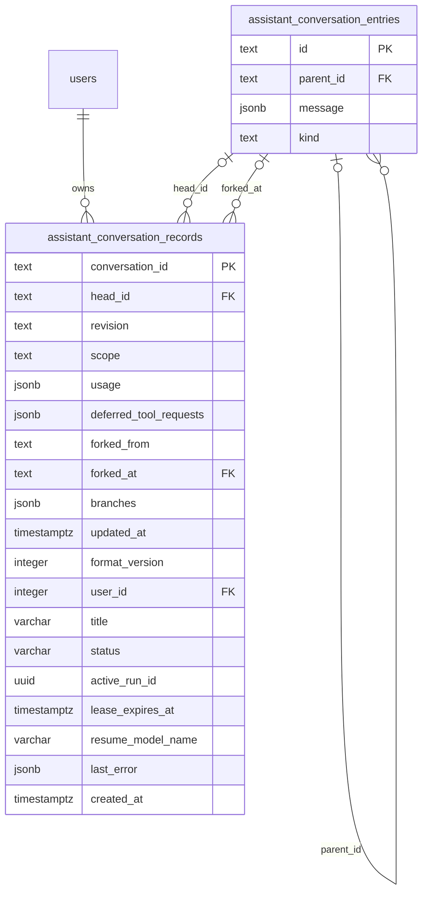

# Agent 会话与消息表设计

目标存储为 `assistant_conversation_records` + `assistant_conversation_entries`，不新增 Action 表。完整字段字典、约束与 Backend 约定见 [ConversationStore 方案](ConversationStore方案.md#3-已确定的表结构)。

ORM 已在 `evalforge/db/orm/assistant.py` 定义，通过 `evalforge.db.models` 导入 `AssistantConversationRecord`、`AssistantConversationEntry`。迁移 `20261118_conversation_store` 创建新表，启动前需应用。助手运行链路已接入。

## ER 图

## 业务字段与消息元数据

- Record 在框架字段外增加 `user_id`、`title`、`status`、`active_run_id`、`lease_expires_at`、`resume_model_name`、`last_error`、`created_at`。
- `scope` 非空且等于后端派生的 `user:{user_id}`，不信任客户端传入的归属。
- Entry 不加 `conversation_id`、消息序号或其他业务列。完整 `message` 已包含供应商、模型和工具信息；原始用户文本、`page_context`、`source_experiment_id` 按需存入 `message.metadata.evalforge`。
- Entry 通过 `parent_id` 形成共享历史链，Record 的 `head_id` 指向当前末端。Fork 可复用已有 Entry；删除 Record 不级联删除 Entry。`forked_from` 仅记录来源 ID，不建外键，来源删除不影响 Fork。

## 执行权

- `revision` 是保存时的乐观并发 Token；不另加整数 version，不用于控制模型执行权。
- `active_run_id` 和 `lease_expires_at` 同空或同非空，`status=running` 与存在租约对应；`awaiting_approval` 要有待处理请求。
- 短事务领取执行权 → 事务外运行模型与工具 → 保存后释放；默认 180 秒租约、60 秒续租。心跳不改变 Revision，等待审批不占用执行权。
- 执行者续租、业务动作前检查、保存及释放均校验持有者。租约不能撤销已经执行的业务操作，异常结果不确定时仍需查询和对账。

## 与当前运行代码的衔接

当前助手使用 ConversationStore 保存完整消息、待审批请求和 Revision，Record 保存执行租约及状态。Run 完成时消息和执行状态在同一事务中提交。

旧会话和消息表保留，已有 SQL 历史导入为只读会话。新运行只写 Record/Entry，原 fake 已移除。

部署迁移与现有助手启用方式见 [评测助手](assistant.md)。Runner 凭证通过 SSE display 卡片直接交付，业务幂等和故障对账仍由业务服务负责。
