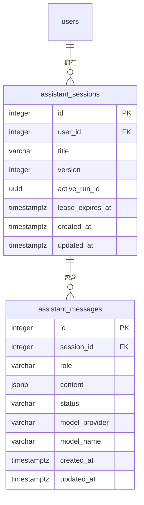

# Agent 会话与消息表设计

本文记录 EvalForge 内置助手首版数据结构。ORM 在 `evalforge/db/orm/assistant.py`，数据库升级与使用方法见 [评测助手接入](assistant.md)。

## assistant_sessions

一条记录代表一个用户的独立助手会话。

| 字段 | 类型 | 约束 / 默认值 | 含义 |
| --- | --- | --- | --- |
| id | integer | 主键，自增 | 会话 ID |
| user_id | integer | 非空，外键 → users.id | 会话所属用户 |
| title | varchar(200) | 非空，默认“新对话” | 会话标题 |
| version | integer | 非空，默认 0，≥ 0 | 会话历史修订号，用于检测并发修改 |
| active_run_id | uuid | 可空 | 当前持有执行权的一轮对话 ID |
| lease_expires_at | timestamptz | 可空 | 当前执行权的租约到期时间 |
| created_at | timestamptz | 非空，默认数据库当前时间 | 创建时间 |
| updated_at | timestamptz | 非空，默认数据库当前时间 | 会话或消息最近更新的时间 |

- `active_run_id` 和 `lease_expires_at` 要么同时为空，要么同时非空。
- 索引：`(user_id, updated_at DESC, id DESC)`，用于查询用户的会话列表。
- 删除用户时级联删除其会话；删除会话时级联删除消息。接口所有读写必须校验所属用户。
- `updated_at` 在新增或更新消息的同一事务中显式更新。

## assistant_messages

每行是一条会话消息。按同一会话内的 `id` 升序读取。

| 字段 | 类型 | 约束 / 默认值 | 含义 |
| --- | --- | --- | --- |
| id | integer | 主键，自增 | 消息记录 ID |
| session_id | integer | 非空，外键 → assistant_sessions.id，ON DELETE CASCADE | 所属会话 |
| role | varchar(16) | 非空；user / assistant / tool | 消息角色 |
| content | jsonb | 非空 | 文本、工具调用或工具结果的结构化内容 |
| status | varchar(16) | 非空，默认 completed；completed / interrupted / failed | 消息状态 |
| model_provider | varchar(100) | 可空 | 本条助手消息实际使用的供应商 |
| model_name | varchar(200) | 可空 | 本条助手消息实际使用的模型 |
| created_at | timestamptz | 非空，默认数据库当前时间 | 创建时间 |
| updated_at | timestamptz | 非空，默认数据库当前时间 | 最后更新时间 |

- 索引：`(session_id, id)`，用于读取和分页展示会话历史。
- `role = assistant` 时保存实际使用的模型；`user` 和 `tool` 的模型字段为空。同一轮若有多条助手消息，每条记录其实际模型。请求中指定的模型须经后端验证；不保存 API Key。
- `content` 存储 `{"v":1,"message":{...}}`，其中 `message` 由 Pydantic AI 的 `ModelMessagesTypeAdapter` 序列化。用户和最终助手消息另带可展示的 `text`；用户消息可附当轮的 `page_context`，组装模型输入时再从元数据渲染。成功读取进度的最终回答还带 `source_experiment_id`。工具调用和结果成对保存在历史，接口返回可展示消息及其元数据。
- `status` 描述消息持久化状态，不代表 Agent 的实验执行状态；首版用户消息通常为 `completed`。

## PostgreSQL 短事务与租约

目标：同一会话同一时刻只允许一个**有效持有者**执行；不同会话可以并行。模型请求期间不持有数据库事务或连接。

1. **领取。** 生成随机 `run_id`。在短事务中按会话 ID、用户 ID、预期 `version`，以及“没有执行权或租约已过期”条件原子更新 `active_run_id` 和 `lease_expires_at`，使用数据库时间判断过期。更新失败时区分会话不存在、历史已变化或正在运行；历史冲突和运行中返回 `409`。
2. **执行。** 提交领取事务，再调用模型和工具。默认租约 45 秒、每 10 秒续租；仅当 `active_run_id = run_id` 且租约尚有效时更新到期时间。
3. **保存并释放。** 在一个短事务中锁定会话行，校验用户、`active_run_id` 和租约仍有效；写入本轮消息、递增 `version`、更新 `updated_at`，然后清空执行权。任何检查失败都不提交本轮消息。
4. **异常与接管。** JSON 和 SSE 共用同一份历史，均只提交完整成功的轮次。失败、超时或协程被取消时，尝试按持有者条件释放；进程崩溃后由租约到期允许新请求领取。旧执行如果恢复，续租、保存和释放都因持有者不匹配或租约过期而失败。

租约不能强制停止已经发出的模型请求。上述校验防止过期执行写入会话；未来若接入有副作用的工具，必须在实际执行动作时另外校验当前执行权、用户权限和确认状态，不能仅依赖模型调用前的检查。

## 暂缓扩展

首版工具只读。需要确认后创建资源或启动实验时，再设计待确认操作的持久化、一次性确认和幂等机制；长期任务与聊天执行权分开管理。
