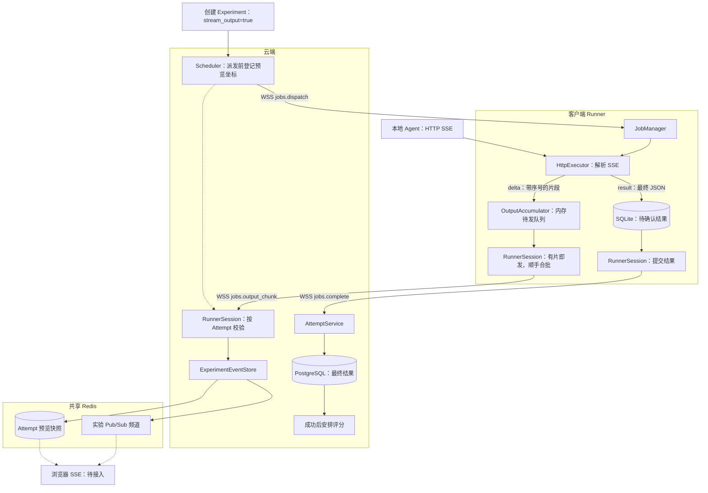

# Agent 流式输出设计

流式执行分两条链路：**`delta` 走 Redis，供实时预览；`result` 走 SQLite → PostgreSQL，作为最终输出和评分输入。** Runner、云端接收及 Redis 发布已实现；浏览器 SSE 待接入。

## 整体架构

## 组件与链路

| 位置 | 组件 | 职责 |
| --- | --- | --- |
| 云端派发 | [ExperimentService](../evalforge/server/services/experiments.py)、[Scheduler](../evalforge/server/scheduler.py) | 创建实验时保存 `stream_output`，默认关闭；所选 Runner 须在线，流式还要求 `http_json` 和 `http_sse`。会话 ready 后派发，发送前登记 `(experiment_id, job_id, attempt_id)`。 |
| 客户端执行 | [JobManager](../client/evalforge_client/job_manager.py)、[HttpExecutor](../client/evalforge_client/http_executor.py) | 将模式写入本地 Attempt。用原目标 URL 和样本 JSON 调用 Agent，带上 `Accept: text/event-stream`。解析 `delta` 和 `result`；流结束时仍没有合法的 `result`，记为执行失败。 |
| 客户端上报 | [OutputAccumulator](../client/evalforge_client/stream_output.py)、[RunnerSession](../client/evalforge_client/session.py) | 每片带 `seq`，内存队列最多 64 片。有片就唤醒发送协程，每批最多 16 片，发完不固定等待。`jobs.output_chunk` 是无 ACK 的通知，首片可以早于 `jobs.started`。 |
| 云端接收 | [WSS 路由](../evalforge/server/routes/runner_ws.py)、[RunnerSession](../evalforge/server/runner_sessions.py) | 在内存里比对 `(job_id, attempt_id)`，直接交给 Hub，不进会话业务队列，也不逐批重查身份。每条会话最多一批在写 Redis；忙时可以丢片。 |
| 云端预览 | [ExperimentEventStore](../evalforge/server/experiment_events.py) | 用一个 Redis 脚本按 Attempt 更新快照，再把整批新片段发布到 `evalforge:experiment:<experiment_id>:events`。同一次 Attempt 按 `seq` 去重，跳号标记缺片。 |
| 云端结算 | [AttemptService](../evalforge/server/services/attempts.py) | Runner 先将终态写入 SQLite，再调用 `jobs.complete`；云端提交 PostgreSQL 后返回 ACK，成功结果进入评分。重连可以补交未确认的结果。 |

## 预览保留与多实例

- **快照**：按实验和 Attempt 保留已收到的前缀，最多 256 KiB 或 1,024 片，最后一次有效更新后保留 10 分钟。达到上限时标记截断，新片仍可实时发布。
- **实时通知**：Pub/Sub 不保存历史。队列满、Redis 写入慢或连接断开时允许丢预览；重连不重新授权旧 Attempt。完成落库、派发未受理或关闭连接后撤销上报资格；已经在途的批次仍归原 Attempt。
- **浏览器 SSE（待接入）**：浏览器可以连到任意实例。该实例先订阅实验频道，再读 Redis 快照，用每个 Attempt 的 `seq` 衔接实时片段。创建实验接口不需要为订阅改动。

相关：[Runner 上报协议](EvalForge_Runner_JSON-RPC_Protocol_v1.md#28-jobsoutput_chunk) · [云端评分链路](server-evaluations.md)
