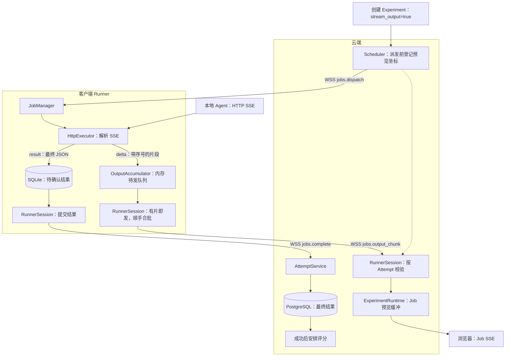

# Agent 流式输出设计

`delta` 写入云端进程内的 Job 缓冲，通过浏览器 SSE 实时预览。`result` 走 SQLite → PostgreSQL，作为最终输出和评分输入。

## 整体架构

## 组件与链路

| 位置 | 组件 | 职责 |
| --- | --- | --- |
| 云端派发 | [ExperimentService](../evalforge/server/services/experiments.py)、[Scheduler](../evalforge/server/scheduler.py) | 创建实验时保存 `stream_output`，默认关闭；所选 Runner 须在线，流式还要求 `http_json` 和 `http_sse`。会话 ready 后派发，发送前登记 `(experiment_id, job_id, attempt_id)`。 |
| 客户端执行 | [JobManager](../client/evalforge_client/job_manager.py)、[HttpExecutor](../client/evalforge_client/http_executor.py) | 将模式写入本地 Attempt。用原目标 URL 和样本 JSON 调用 Agent，带上 `Accept: text/event-stream`。解析 `delta` 和 `result`；流结束时仍没有合法的 `result`，记为执行失败。 |
| 客户端上报 | [OutputAccumulator](../client/evalforge_client/stream_output.py)、[RunnerSession](../client/evalforge_client/session.py) | 每片带 `seq`，内存队列最多 64 片。有片就唤醒发送协程，每批最多 16 片，发完不固定等待。`jobs.output_chunk` 是无 ACK 的通知，首片可以早于 `jobs.started`。 |
| 云端接收 | [WSS 路由](../evalforge/server/routes/runner_ws.py)、[RunnerSession](../evalforge/server/runner_sessions.py) | 在内存里比对 `(job_id, attempt_id)`，直接追加片段并唤醒读者。 |
| 云端预览 | [JobPreview](../evalforge/server/experiment_events.py) | 从内存生成 `snapshot` 和 `delta`。同一次 Attempt 按 `seq` 去重，跳号标记缺片。 |
| 云端结算 | [AttemptService](../evalforge/server/services/attempts.py) | Runner 先将终态写入 SQLite，再调用 `jobs.complete`；云端提交 PostgreSQL 后返回 ACK，成功结果进入评分。重连可以补交未确认的结果。 |

## 预览保留与多实例

- 每个活跃流式 Job 保留最多 256 KiB UTF-8 文本或 1,024 个合并后的段。连续短片合并到最多 8 KiB 的段，达到上限后淘汰最早的段。
- `GET /api/v1/experiments/{experiment_id}/jobs/{job_id}/events` 在建连时鉴权并校验 Job 状态。Nginx 把请求转到 Runner 所在实例。生成器先发 `snapshot`，后发 `delta`，两者带 `attempt_id`、`text`、`truncated`、`has_gap`。如果读者落后到旧段已被淘汰，重新发一份 `snapshot`，页面替换预览。空闲时每 15 秒发心跳。
- Job 结果提交后清空预览并发送 `done`，页面通过普通 Job 详情读取最终输出。派发失败或 Runner 会话清理时结束旧流并发送 `interrupted`。浏览器重新查询状态，仍运行时可重新订阅。Runner 重连前已经开始执行的 Attempt，其预览可能无法恢复，结果仍可补交。

相关：[Runner 上报协议](EvalForge_Runner_JSON-RPC_Protocol_v1.md#28-jobsoutput_chunk) · [云端评分链路](server-evaluations.md)
