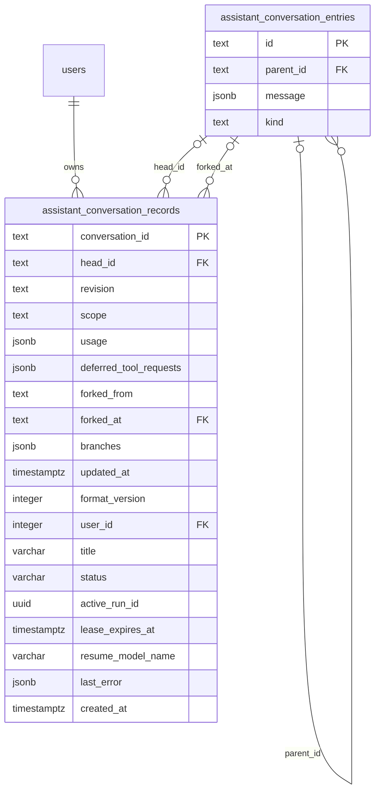

# EvalForge Assistant — ConversationStore存储设计方案

> 状态：表结构、ORM 与增量迁移已定义；数据库 Backend 尚未接入｜日期：2026-11-18
> 适用范围：EvalForge Assistant的Conversation持久化、历史管理与Deferred Tools恢复。

## 1. 设计决策

- 使用PydanticAI的`ConversationStore`，基于现有SQLAlchemy/Alembic实现数据库Backend。
- **只新建两张表**：`assistant_conversation_records`、`assistant_conversation_entries`；暂不建立独立`Action`表。
- 最终由 Record 替代旧 `assistant_sessions`、Entry 替代旧 `assistant_messages`。当前代码仍使用旧表和 fake Conversation，故本次只新增 ORM 与迁移，不删除旧表、不搬运历史数据，也不改变运行链路。
- **每次Agent Run结束后保存一次**；普通SSE片段和普通Tool调用过程中不逐条写库。因Deferred Tools暂停也视为一次Run结束。
- `ConversationStore`负责增量追加、历史重建、Revision校验、Branch/Fork逻辑；EvalForge负责SQL、事务、身份隔离与业务幂等。
- 多个待审批调用由前端一次性收集全部批准/拒绝结果，再提交恢复；不持久化逐项点击的中间决定。
- 前端管理上次打开的`conversation_id`；后端始终按登录用户/组织校验会话归属。

## 2. 数据模型与关系



- `ConversationRecord`保存会话身份、当前消息链末端`head_id`、累计用量、待处理Deferred Tools、分支及并发版本。
- `ConversationEntry`保存一条完整`ModelMessage`及`parent_id`（上一条Entry ID）。
- 加载会话：从`head_id`沿`parent_id`向前追溯，再按旧到新排列，组合成`Conversation`。
- Entry**不设置`conversation_id`**：多个Conversation可以共享相同的历史Entry；Fork仅创建新Record并复用已有历史，Branch保留旧链并生成新链。它们不回滚任何已执行的业务操作。

## 3. 已确定的表结构

PydanticAI 规定对象的数据与存储语义，不强制 SQL 列结构。框架字段沿用官方 `snake_case`，Record 增加 EvalForge 业务字段。ORM 位于 `evalforge/db/orm/assistant.py`，统一从 `evalforge.db.models` 导入 `AssistantConversationRecord` 和 `AssistantConversationEntry`。

### 3.1 `assistant_conversation_records`

| 字段 | 类型 / 默认值 | 用途 |
|---|---|---|
| `conversation_id` | TEXT，主键 | 会话唯一标识 |
| `head_id` | TEXT，可空，FK → entries.id | 当前历史末端 Entry ID |
| `revision` | TEXT，非空 | 乐观并发控制的不透明版本Token |
| `scope` | TEXT，非空 | 后端派生为 `user:{user_id}`，当前不引入组织 |
| `usage` | JSONB，非空，默认 `{}` | 完整 RunUsage；由适配器恢复类型默认值 |
| `deferred_tool_requests` | JSONB，可空 | 完整待审批/外部工具请求 |
| `forked_from` | TEXT，可空 | 来源会话 ID，仅为出处信息，不建外键，来源删除后仍保留 |
| `forked_at` | TEXT，可空，FK → entries.id | Fork 保留的最后一个 Entry |
| `branches` | JSONB，非空，默认 `[]` | 离开过的历史分支 HEAD 列表 |
| `updated_at` | timestamptz，非空，默认数据库当前时间 | 最近保存时间，由 Backend 显式更新 |
| `format_version` | INTEGER，非空，默认 `1` | 当前仅支持格式 1 |
| `user_id` | INTEGER，非空，FK → users.id | **业务**：会话所有者，删除用户级联删除 Record |
| `title` | VARCHAR(200)，非空，默认“新对话” | **业务**：会话标题，不能全为空格 |
| `status` | VARCHAR(24)，非空，默认 `completed` | **业务**：completed / running / awaiting_approval / failed |
| `active_run_id` | UUID，可空 | **业务**：当前执行权持有者 |
| `lease_expires_at` | timestamptz，可空 | **业务**：执行租约到期时间 |
| `resume_model_name` | VARCHAR(200)，可空 | **业务**：暂停时选择的模型，审批恢复沿用；非空时不能全为空格 |
| `last_error` | JSONB，可空 | **业务**：最近运行错误 `{code, message}`，不放敏感内容 |
| `created_at` | timestamptz，非空，默认数据库当前时间 | **业务**：创建时间 |

**约束与索引：**

- `conversation_id`、`revision` 非空白；Revision 只比较相等性，不按数值或时间排序。不另加整数 version。
- `scope = 'user:' || user_id`，由数据库检查保证与所有者一致；新增组织能力时再调整规则。
- 两个租约字段同时为空或同时非空；`status=running` 当且仅当存在执行权。
- `awaiting_approval` 必须有非 SQL NULL 的 `deferred_tool_requests`；其中 approvals 的非空、合法参数等形状由 Backend 校验。
- 列表索引：`(scope, updated_at DESC, conversation_id DESC)` 和 `(user_id, updated_at DESC, conversation_id DESC)`。
- `head_id`、`forked_at` 各有普通索引与 RESTRICT 外键，防止删除仍被引用的共享 Entry。

### 3.2 `assistant_conversation_entries`

| 字段 | 类型 / 默认值 | 用途 |
|---|---|---|
| `id` | TEXT，主键 | Entry唯一标识（框架默认UUIDv7字符串） |
| `parent_id` | TEXT，可空，FK → entries.id，RESTRICT | 上一条 Entry ID，首条为 NULL |
| `message` | JSONB，非空 | 完整 ModelMessage，含工具调用、结果和 metadata |
| `kind` | TEXT，非空，默认 `message` | 当前检查约束只允许 message |

- **不添加**`conversation_id`、`message_index`或独立Action表。
- `message`、`usage`、`deferred_tool_requests`需要使用与PydanticAI类型兼容的序列化/反序列化；不能只存前端聊天文本。
- `parent_id`必须允许指向共享Entry；删除Record时不得直接按会话级联删除共享历史。
- `id` 非空白；`parent_id` 不能等于自身，且有普通索引。更长的环、链可达性与不可变消息规则由 Backend 保证。
- **不额外添加业务列**。模型供应商和模型名称保留在 ModelResponse 内；原始文本、页面上下文和数据来源等放在 `message.metadata.evalforge`，不能只保存前端文字。完整消息用库的适配器序列化。
- SQL JSON 类型在 PostgreSQL 为 JSONB，SQLite 测试使用通用 JSON；可空 JSON 的 None 保存为 SQL NULL。
- `branches` 中的 ID、共享链归属及跨用户 Fork 由 Backend 校验。Entry 不直接对外暴露按 ID 任意读取的接口。

### 3.3 执行权与迁移边界

- 沿用短事务领取、45 秒租约、10 秒续租的方式；模型请求与业务 API 等待均在事务之外。
- 领取、续租、保存和释放都检查当前持有者。等待审批时释放租约，不保留协程或长期数据库锁。
- 心跳只更新租约，不推进 `revision`；`write_record` 更新框架字段时不得覆盖标题、归属、租约和恢复配置等业务列。
- `revision` 负责保存冲突，租约负责执行权；租约过期不证明副作用没有发生。`last_error.code=assistant_execution_uncertain` 用于阻止盲目重放，实际幂等与对账仍由业务 Service 负责。
- 新迁移 `20261118_conversation_store` 仅创建两张新表，接在 `20261117_trace` 之后。不自动执行迁移，不删除原会话/消息表，不迁移旧历史；当前 fake 运行方式保持不变。
- 后续完成 Backend、接口 ID/Revision 适配与历史迁移后，再移除 `AssistantSession`、`AssistantMessage` 及旧表。最终收敛为两张表，而不是长期维护两套会话存储。

## 4. ConversationStore Backend

继承`pydantic_ai.conversation_store.ConversationStore`，按当前官方接口实现以下**5个必需方法**：

```python
async def read_record(conversation_id: str) -> ConversationRecord | None: ...

async def read_records(
    *, scope: str | None = None, limit: int | None = None
) -> Sequence[ConversationRecord]: ...

async def write_record(
    record: ConversationRecord,
    *, new_entries: Sequence[ConversationEntry] = (),
    expected_revision: str | None,
) -> None: ...

async def delete_record(
    conversation_id: str, *, expected_revision: str
) -> None: ...

async def read_entry(entry_id: str) -> ConversationEntry: ...
```

- `read_record`：按ID读取并恢复Record。
- `read_records`：可按`scope`筛选，按`updated_at`倒序，支持`limit`。
- `write_record`：同一短事务中插入新增Entry并更新Record，严格检查`expected_revision`及`head_id`有效性；冲突抛出`ConversationConflict`。首次保存仅当记录不存在时插入。
- `delete_record`：按预期Revision删除Record；共享Entry的清理需另行设计，MVP可先保守保留孤立Entry。
- `read_entry`：按ID读取并恢复完整Entry。

**建议额外重写（非必需）：**

```python
async def read_history(
    head_id: str | None, *, limit: int | None = None
) -> list[ConversationEntry]: ...
```

基类的`load()`等方法已经通过`self.read_history()`调用它；子类同名覆盖即可生效，**无需注册**。建议使用SQLite/PostgreSQL递归CTE批量读取，减少默认沿`parent_id`逐条查库的N次查询。返回顺序必须为**旧→新**，并正确处理`limit`、缺失Entry。

## 5. 会话写入与Deferred Tools链路

### 普通Agent Run

```python
conversation = await store.load(conversation_id, scope=scope)
if conversation is None:
    conversation = Conversation(conversation_id=conversation_id)

result = await agent.run(user_input, conversation=conversation, deps=deps)
await store.save(result, scope=scope)
```

### 需要用户审批

1. Agent遇到`requires_approval=True`的工具，结束本次Run；`result.conversation.deferred_tool_requests`自动包含待审批调用。
2. **先**`store.save(result, scope=scope)`，成功后再向React发送SSE `action_required`（附`tool_call_id`、工具名、参数）；本次流以`done(status=awaiting_approval)`结束。
3. 用户刷新页面：按`conversation_id`加载会话，读取`deferred_tool_requests.approvals`，重新生成审批卡片。
4. 前端收集**全部**审批结果，一次性向统一`POST /assistant/stream`提交`type=decision`、会话ID及`tool_call_id → approve/deny`映射。
5. 后端校验会话归属、全部待处理ID与审批权限，构造`DeferredToolResults`，使用原Conversation启动**新的**`agent.run(conversation=..., deferred_tool_results=..., deps=...)`。
6. 新Run结束后再次`store.save(result, scope=scope)`；可能完成，也可能返回下一批Deferred Tools。统一走原SSE结果处理逻辑。

**统一约定：** 不将逐Token SSE、普通Tool进度逐项写库；只有Run完成或Deferred暂停形成可保存的Conversation时写库。`action_required`与最终`done`须在持久化成功后发出。

## 6. 并发、可靠性与边界

- `revision`只用于检测**保存时**的并发覆盖，不能防止两个Run事先重复执行副作用工具。一个Conversation同时只允许一个运行/恢复者；需要服务端执行权控制，而不只是前端禁用按钮。
- `write_record`执行Revision条件更新、Entry插入必须在**同一数据库事务**；不要在事务内等待LLM或外部API。
- 业务写操作仍须按稳定业务操作标识设计幂等/结果对账；**ConversationStore不是Durable Execution，也不是审批审计账本**。
- `scope`必须由认证后的用户/组织派生；不能直接相信客户端输入。跨进程或重启后由数据库`load()`恢复，不依赖内存里的Conversation对象。
- 前端只在本次页面会话中保存尚未统一提交的逐项审批选择；刷新可能丢失这些**未提交**选择，但已持久化的待审批请求不会丢失。
- UI“上次打开的会话ID”由前端管理；ConversationStore只负责根据ID加载会话，不会自动识别用户最后查看的Record。
- `branch()`/`fork()`可保留/共享历史消息，但不会撤销过去已创建的Runner或执行过的Experiment。

## 7. 验收要点

- 新建、连续多轮对话后可跨进程重新加载完整历史；每轮只追加新Entry。
- Deferred Tools暂停后刷新仍可恢复卡片；全量批准/拒绝后能继续Agent。
- 两个并发写入同一Revision，最多一个成功，其余抛出`ConversationConflict`。
- Fork/Branch不复制共享历史、不破坏旧分支；删除Record不会破坏其他会话。
- `read_history`对长历史及`limit`返回结果与默认实现一致。
- SSE断开或工具执行异常时，不能仅凭流连接状态推断业务操作是否成功。

## 8. 资料及版本约束

本方案基于2026-11-18查阅的PydanticAI官方文档。实现时应固定PydanticAI依赖版本，并对该版本的类字段与抽象方法签名编写测试。

- [ConversationStore API（字段、5个抽象方法与read_history）](https://pydantic.dev/docs/ai/api/pydantic-ai/conversation-store/)
- [Persistence（增量保存、Revision、Branch、Fork）](https://pydantic.dev/docs/ai/core-concepts/persistence/)
- [Deferred Tools（暂停与恢复）](https://pydantic.dev/docs/ai/tools-toolsets/deferred-tools/)
