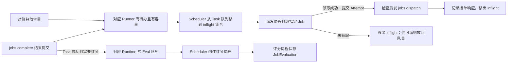

# ExperimentRuntime 改造计划（临时）

> 首版已接入。代码与行为见 [运行时说明](server-experiment-runtime.md) 和 [云端评分链路](server-evaluations.md)。

目标：把 Scheduler 从「醒来就扫所有 ready Runner、派发协程再查库找 Job」改为「只处理有待办且有容量的 Runner」。数据库继续保存 Job、Attempt 和评分；Scheduler 主循环只做内存匹配。

## 待办怎么进入调度

- 每个实验一个 `ExperimentRuntime`，保存固定执行配置、评分快照、Task 队列、Task 派发 `inflight` 集合和 Eval 队列。`JobWorkItem` 携带 `job_pk`、协议 `job_id`、样本 ID 和固定的输入。
- 实验创建事务提交后，由持有目标 Runner 的 `ready` 会话的实例加载待办。同一会话下按实验 ID 创建或更新，避免重复建立 Runtime。Runner 尚未 `ready` 时，Job 留在数据库，等会话就绪时加载。
- Runner 就绪、容量释放、待办加载完成时，只重新检查对应的 Runner。Scheduler 消费按 `runner_id` 去重的可派发队列，不遍历 Runtime 字典。Eval 入队时也通知 Scheduler，只处理有评分待办的 Runtime。
- 首版按实验一次加载当前待办，不做分批补货。一次加载只决定有多少待办进内存；Task 仍按 Runner 容量派发，Scheduler 主循环不等待查库。以后单个实验的内存占用或加载耗时成为问题时，再考虑分批加载。

## 一次派发怎么走

- Scheduler 启动派发协程前，在同一步把 Job 从 Task 队列移到 Runtime 的 `inflight` 集合。派发协程调用统一收尾方法移出 `inflight`：Runner 忙时放回队首，等容量通知再试；候选已取消或已被领取时不回队。派发期间收到容量更新，收尾后再检查一次，避免漏唤醒。
- `DispatchService` 在短事务中领取**指定** Job，确认 Job、实验和 Runner 的状态，利用现有唯一约束防止重复占位。省掉查「下一条是谁」和重复读取输入。发送前确认会话仍有效；首版保留 `prepare_send()` 的取消检查，后续再评估是否合并。
- `inflight` 只跟踪派发。派发协程只等数据库事务和 `jobs.dispatch` 的接单响应，等 RPC 时不持有事务。收到 `accepted` 即结束派发，活跃 Attempt 继续占用 Runner 容量，结果由 `jobs.complete` 独立提交。领取成功后，只有数据库确认 Job 回到 `queued` 才能回队；送达不明时走现有 `unknown` 与重连对账。取消通知要能单独触发，不能依赖 Runner 空闲或队列有 Job。

## 评分与正常释放

- `jobs.complete` 成功结果提交后，使用已提交的输出和实验评分快照构造 `EvaluationWorkItem`，加入同一个 Runtime 的 Eval 队列，再唤醒 Scheduler。Task 失败或没有配置评分时不入 Eval 队列。
- Scheduler 取出待办并按需启动评分协程。协程拿到完整的工作项后独立评分、保存 `JobEvaluation` 并推进实验收尾，不依赖 Runner 连接，也不依赖 Runtime 仍在注册表中。首版不做 Eval 限流或并发限制。
- 正常运行时，Task 和 Eval 都收尾、数据库中的 Experiment 进入终态后，再移除 Runtime。最后一个 Job 被 `accepted` 或两个队列暂时为空，都不代表实验结束：Agent 可能还在运行，评分也可能尚未入队或正在执行。取消沿用现有业务收尾规则，并停止新的 Task 派发。

## 启动与会话接管

- 云端进程启动时只初始化服务，Runtime 注册表为空，不扫描实验，也不全局补查缺失评分。实验恢复由 Runner 会话进入 `ready` 触发。
- Runner 首次连接或重连，完成对账与结果补传并进入 `ready` 后，由持有该会话的实例读取该 Runner 的未结束实验。每个实验重建一个完整的 Runtime：一次装入 `queued` Job 和 Task 已成功但缺少 `JobEvaluation` 的评分项，然后注册并通知 Scheduler。只剩评分或仍有 Agent 在运行的实验也要重建，即使当前队列为空。活跃 Attempt 仍占容量，不重复派发；`unknown` 不占容量；新 Runtime 的派发 `inflight` 从空集合开始。
- 多实例按 Runner 会话归属恢复，无需分配全局扫描范围。例如实例 A 崩溃后，Runner 重连到 B，由 B 重建该 Runner 的 Runtime。Runner 不重连，属于它的待办暂留数据库，包括待评分项。
- 旧会话失效时，旧实例停止新派发，让已启动的派发协程收尾，再按 `session_id` 清理旧 Runtime，避免误删新会话的对象。已启动的评分协程可继续落库。内存队列不迁移；评分待办可由成功的 Job、评分快照与已保存的 `JobEvaluation` 重建。
- 本阶段暂不做跨实例通知或低频补查：创建、取消请求落到其他实例时仍会提交数据库，但不会立即唤醒会话所在实例。创建待办等 Runner 下次进入 `ready` 时加载；已持久化的取消意图可由重连对账或后续派发校验发现。

## 实施顺序

1. **准备待办与通知**：定义 `JobWorkItem`，接通实验提交后加载、会话 ready、Attempt 收尾和取消事件。按 Runner 组织可派发候选。
2. **替换 Task 派发入口**：Scheduler 从内存选 Job，派发协程领取指定 Job；去掉正常链路每秒扫描所有 `ready` Runner。
3. **接通 Eval 与实验收尾**：Task 结果提交后直接给对应 Runtime 添加评分待办，Scheduler 按需启动评分协程。实验进入终态后释放 Runtime。
4. **接入会话接管与恢复**：把现有启动评分补查移到 Runner `ready` 后，并入完整 Runtime 重建。验证云端崩溃后跨实例重连、只剩评分、Agent 仍在执行等场景，并覆盖容量不足、取消和回执晚于结果。
