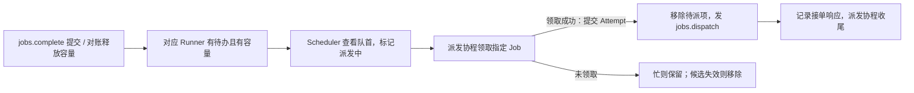

# ExperimentRuntime 改造计划（临时）

> 设计草案，尚未接入。现有链路见 [运行时说明](server-experiment-runtime.md) 和 [云端评分链路](server-evaluations.md)。

目标：把 Scheduler 从「醒来就扫所有 ready Runner、派发协程再查库找 Job」改为「只处理有待办且有容量的 Runner」。数据库继续保存 Job、Attempt 和评分；Scheduler 主循环只做内存匹配。

## 待办怎么进入调度

- `ExperimentRuntime` 按实验保存固定执行配置和待派队列。`JobWorkItem` 携带 `job_pk`、协议 `job_id`、样本 ID 和固定的输入；共享执行配置放在 Runtime。
- 实验创建提交后，通知加载该实验的待办。Runner 进入 ready、容量释放、待办加载完成时，只重新检查对应的 Runner。Scheduler 消费按 `runner_id` 去重的可派发队列，不遍历 Runtime 字典。
- **补货是分批加载已入库的 `queued` Job。** 第一版可按实验加载；如果需要限制内存，再由独立加载协程按批补货。队列为空但还有未加载数据时，触发加载，不能当成实验结束。

## 一次派发怎么走

- 队列由 Scheduler 更新。查看队首后只记「该 Runner 正在派发」，领取成功再出队；第一版不另建 inflight 队列。Runner 忙时不创建 Attempt、不发 RPC、Job 留队，等下一次容量通知。已取消或已被领取的候选移除。派发期间收到容量更新，收尾后再检查一次，避免漏唤醒。
- `DispatchService` 在短事务中领取**指定** Job，确认 Job、实验和 Runner 的状态，利用现有唯一约束防止重复占位。省掉查「下一条是谁」和重复读取输入。发送前确认会话仍有效；首版保留 `prepare_send()` 的取消检查，后续再评估是否合并。
- 派发协程只等数据库事务和 `jobs.dispatch` 的接单响应，等 RPC 时不持有事务。收到 `accepted` 不表示 Runner 有空位；结果仍由 `jobs.complete` 独立提交。已发送后被拒绝或结果不明，沿用现有 Attempt、重排和重连规则。取消通知要能单独触发，不能依赖 Runner 空闲或队列有 Job。

## 实施顺序

1. **准备待办与通知**：定义 `JobWorkItem`，接通实验提交后加载、会话 ready、Attempt 收尾和取消事件。按 Runner 组织可派发候选。
2. **替换 Task 派发入口**：Scheduler 从内存选 Job，派发协程领取指定 Job；去掉正常链路每秒扫描所有 ready Runner。评分发现暂保留 `notify_eval(job_pk)` 与现有缺项查询，如要让主循环完全不等数据库，把查询移给独立评分协程。
3. **补恢复与多实例**：启动、重连时按数据库状态重建待办，并保留低频对账。事件需要到达持有目标 Runner WSS 的实例；具体转发和 Runtime 归属待定。多实例切换前验证跨实例通知和漏通知恢复。
4. **验证后再扩展**：检查大量空闲 Runner 时不再反复查库，覆盖容量不足、取消、会话替换、回执晚于完成、通知丢失等场景。再决定是否接入分批补货和 Runtime 的 Eval 队列。
