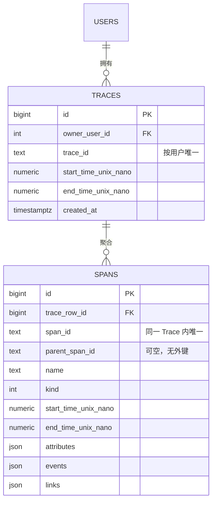

# Trace 与 Span 表设计

遵循 [Trace 接入与语义处理决策](Trace接入与语义处理决策.md)。PostgreSQL 只新增 `traces` 和 `spans`：Trace 用于归属、聚合和列表；Span 保存每次调用的 OTLP 字段，用于画调用树、瀑布图和查看原始详情。

## traces

| 字段 | PostgreSQL 类型 | 含义 |
| --- | --- | --- |
| `id` | BIGINT，PK | 数据库内部 ID |
| `owner_user_id` | INTEGER，FK → `users.id` | 上报鉴权确定的用户归属 |
| `trace_id` | TEXT | 32 位小写十六进制 OTLP Trace ID |
| `start_time_unix_nano` / `end_time_unix_nano` | NUMERIC(20,0) | 已入库 Span 的最早开始、最晚结束 |
| `created_at` | TIMESTAMPTZ | 首次入库时间 |

- 唯一键：`(owner_user_id, trace_id)`。列表索引：`(owner_user_id, start_time_unix_nano DESC, id DESC)`。
- 写入服务按批次更新 Trace 时间范围；晚到的 Span 可以扩大范围。Trace 不设“已完成”状态。

## spans

| 字段 | PostgreSQL 类型 | 含义 |
| --- | --- | --- |
| `id` | BIGINT，PK | 数据库内部 ID |
| `trace_row_id` | BIGINT，FK → `traces.id` | 所属 Trace，引用内部主键 |
| `span_id` / `parent_span_id` | TEXT | 16 位小写十六进制 ID；没有父级时为 NULL |
| `name` / `kind` | TEXT / INTEGER | 上报的调用名称和 OTLP 原生类型 |
| `start_time_unix_nano` / `end_time_unix_nano` | NUMERIC(20,0) | 原始纳秒时间，可直接计算耗时 |
| `status_code` / `status_message` | INTEGER / TEXT，可空 | 上报的状态；未上报时为 NULL |
| `trace_state` / `flags` | TEXT / BIGINT | 追踪状态、标志位；默认空字符串和 0 |
| `attributes` / `events` / `links` | JSON | 原始属性、事件和关联链接，默认空数组 |
| `resource` / `instrumentation_scope` | JSON，可空 | 外层 Resource 和 Scope，各自保留所属层的 `schemaUrl` |
| `dropped_attributes_count` / `dropped_events_count` / `dropped_links_count` | BIGINT | 上报方记录的丢弃计数，默认 0 |

- 唯一键：`(trace_row_id, span_id)`。详情索引：`(trace_row_id, start_time_unix_nano, id)`。接收端可据唯一键忽略重传。
- `parent_span_id` 是同一 Trace 中的 OTLP ID，不设外键，允许父 Span 晚到或缺失。删除 Trace 时级联删除 Span；删除用户时级联删除其 Trace。
- ID 不接受全零；时间保存为无符号 64 位范围内的纳秒整数，结束时间不得早于开始时间。

## 原样展示与评测关联

- 属性保留 OTLP 的 `key` 和带类型的 `value`，包括点号键名、嵌套值和数组顺序。JSON 采用 [OTLP 的字段编码](https://opentelemetry.io/docs/specs/otlp/#json-protobuf-encoding)；64 位整数与纳秒值给浏览器时用十进制字符串。保留解码后的字段和值，不保存整批 protobuf 报文。
- 前端用 ID、时间和状态画图。OpenInference、OTel GenAI 和自定义属性按原名原值展示，不据此归类，也不派生 Token、模型等专用统计。
- `Job.trace_id`（表 `experiment_runs`）对应最终采用的执行；`RunnerAttempt.trace_id` 对应单次尝试。两者由 `jobs.complete` 写入，可空，不设 Trace 外键。读取时按用户归属和 Trace ID 匹配。[OTLP 接收](OTLP接收.md)与评测结果分别入库，先后顺序不限。

已有数据库应先执行迁移 `20261117_trace`，再运行包含新 ORM 的应用；自管迁移链应先接入该迁移。
