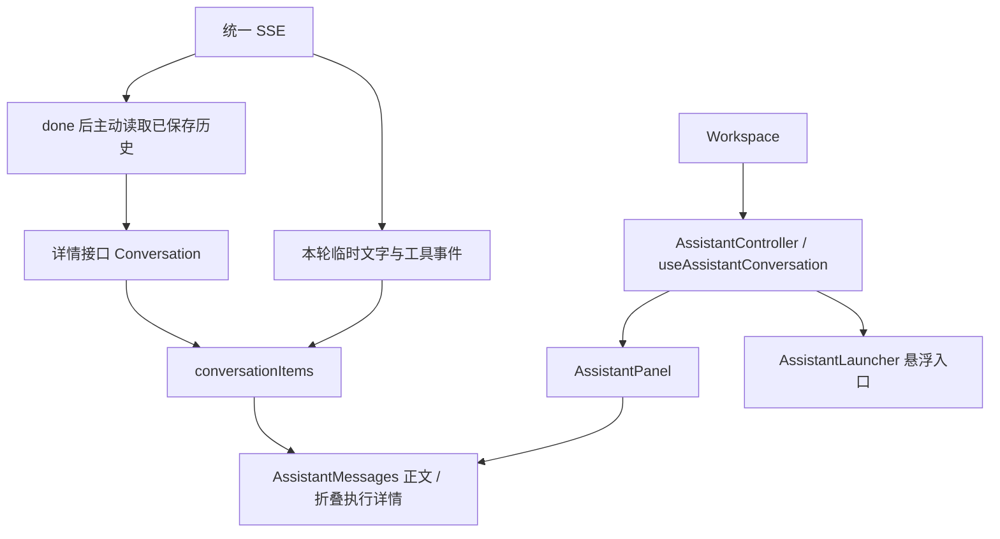

# EvalForge 评测助手

助手已使用数据库 `ConversationStore`。完整模型消息保存在 `assistant_conversation_entries`，会话 Revision、用量、待审批请求和执行租约保存在 `assistant_conversation_records`。刷新网页或重建后端实例后，都从数据库恢复同一会话。

## 启用

已有核心表且由仓库 Alembic 管理的数据库，启动新版本前执行 `python -m alembic upgrade head`，至少应用 `20261118_conversation_store`。自管迁移链需先接入对应迁移。应用启动时不自动建表。

全新开发库可运行 `Base.metadata.create_all` 创建当前结构，再执行 `python -m alembic stamp head`。配置 `EVALFORGE_ASSISTANT_MODELS`、`EVALFORGE_ASSISTANT_API_KEY`，可选 `EVALFORGE_ASSISTANT_BASE_URL`。默认模型等待 90 秒，执行租约 180 秒，每 60 秒续租。正常完成或暂停后立即释放租约；实例崩溃时，最多约 180 秒后可识别过期状态。配置见 `.env.example`。

## 接口

路径以 `/api/v1/assistant` 开头，沿用登录 Cookie，POST 校验 CSRF。

| 请求 | 响应 |
| --- | --- |
| `POST /sessions`，`{"title":"实验对话"}` | `conversation_id`、`revision`、标题和创建/更新时间 |
| `GET /sessions` | 最近 50 个会话及允许选择的模型 |
| `GET /sessions/{conversation_id}` | 会话摘要、展示用 `conversation`、最近 100 条正文 `messages`、状态、待审批 `actions`、错误 |
| `POST /stream` | 普通消息和整批审批共用 SSE 入口 |
| `POST /sessions/{conversation_id}/chat` | 普通消息的 JSON/SSE 入口，也使用 `expected_revision` |

`conversation_id` 和 `revision` 都是字符串。Revision 是不透明令牌，每次成功保存后更新，客户端原样回传。

普通消息请求示例

```json
{
  "type": "message",
  "conversation_id": "创建接口返回的会话 ID",
  "expected_revision": "最近读取的 Revision",
  "message": "创建一个本地开发 Runner",
  "model_name": "允许的模型名称",
  "page_context": {"type":"experiment","id":7}
}
```

`model_name`、`page_context` 可以省略。页面上下文支持 experiment、job、dataset、runner，后端校验资源归属和父子关系。模型看到页面引用和工具查询结果，用户原始文本、页面上下文和数据来源保存在消息的 `metadata.evalforge`。

审批请求示例

```json
{
  "type": "decision",
  "conversation_id": "同一个会话 ID",
  "expected_revision": "暂停后的 Revision",
  "decisions": {"call_001":true,"call_002":false}
}
```

必须一次提交全部待审批调用的布尔决定。服务端根据保存的 Conversation 恢复模型和工具参数。等待审批期间本轮 Run 已结束，不持有执行租约。

## 会话详情与执行详情

详情接口仍返回原有 `messages` / `actions`，供当前前端使用；新增 `conversation`，供统一助手自行组织正文与执行详情。不新增工具详情接口或数据表。

```json
{
  "conversation_id": "会话 ID", "revision": "最新 Revision", "title": "实验对话",
  "status": "completed", "created_at": "2026-11-19T08:00:00Z", "updated_at": "2026-11-19T08:01:00Z",
  "messages": [], "actions": [], "error": null,
  "conversation": {
    "conversation_id": "会话 ID", "revision": "最新 Revision", "usage": {},
    "messages": [
      {"kind":"response", "run_id":"本轮运行 ID", "parts":[
        {"part_kind":"tool-call", "tool_name":"RUNNER_list_runners", "tool_call_id":"call_1", "args":{"page":1}}
      ]},
      {"kind":"request", "run_id":"本轮运行 ID", "parts":[
        {"part_kind":"tool-return", "tool_name":"RUNNER_list_runners", "tool_call_id":"call_1", "content":{"items":[]}, "outcome":"success"}
      ]}
    ],
    "deferred_tool_requests": null
  }
}
```

示例省略正文与可选时间、模型、用量字段。`conversation.messages` 返回当前分支全部已保存消息，不受正文最近 100 条限制；不包含其他分支和本轮尚未保存的消息。

- 从用户范围的 `ConversationStore.load()` 重建，经原生适配器序列化；保留 `kind` / `part_kind`、模型、时间、run_id、用量、工具调用及返回。
- 当前展示允许用户文本、助手文本、工具调用、工具返回和重试反馈；不导出 system、thinking 等其他 Part、instructions、provider 私有字段、工具 metadata 和存储内部字段。消息 metadata 仅保留 `evalforge.text/page_context/source_experiment_id`。Prompt 中的页面上下文块保持原样，前端可选择 metadata.evalforge.text 展示用户原始输入。
- 历史与实时工具事件共用字段选择规则，不递归检查或替换业务内容。工具 args/content、JSON 字符串和文本原样序列化，不做 Token 正则识别或 `[REDACTED]` 替换。Runner 凭据仍由现有业务逻辑独立通过 `display` 交付，不进入模型历史。
- 前端按 Part 类型渲染；request 可能是工具结果，不能直接等同 user。按 `tool_call_id` 配对调用与结果，按 `run_id` 区分运行；审批恢复产生新的 run_id，保留原调用 ID。
- 这是经过过滤的展示副本，不能作为恢复现场。前端不回传它执行工具，审批仍只提交会话 ID、Revision 和决定；后端始终加载完整原始 Conversation。
- 原始暂停请求可能在执行失败后仍保留；不能仅凭 deferred_tool_requests 非空就允许审批。是否可以提交以外层 status=awaiting_approval 和 actions 为准，failed/running 时禁用。
- 当前采用全量读取；长对话分页、大小控制后续再做，不逐条查询工具详情。

## SSE 与保存

| 事件 | 含义 |
| --- | --- |
| `text_delta` | `{"text":"..."}`，临时文字 |
| `tool_call` | `{conversation_id, run_id, part, args_valid}`，一次工具调用 |
| `tool_result` | `{conversation_id, run_id, part}`，对应工具结果 |
| `tool_deferred` | `{conversation_id, run_id, requests}`，一批调用进入等待审批/外部结果 |
| `approval_required` | `{revision, cards}`，标题、描述、调用 ID 和业务参数 |
| `display` | `{id, tool_call_id, title, description, fields}`，工具产生的展示卡片 |
| `done` | `{"revision":"...","status":"completed 或 awaiting_approval"}` |
| `error` | `{"code":"...","message":"..."}` |

每次 Run 完成或暂停后，在同一短事务中校验执行权、调用 `store.save()` 追加 Entry/更新 Record、更新状态并释放租约，提交成功后发送批准请求和结束事件。工具执行时可通过 display 回调即时发送展示卡片。普通片段不逐条写库。网页通过 sessionStorage 记住当前用户最后选中的会话 ID，刷新后重新读取已保存的审批卡片，未提交的批准/拒绝选择需要重选。

同一会话同时只能有一个有效运行者。领取使用数据库条件更新，心跳只续租，最终保存同时校验运行 ID、有效租约和 Revision。旧运行者无法覆盖新运行者。普通消息中断可重提；审批执行中断或租约过期记录 `assistant_execution_uncertain`，先核对业务状态后新建会话，避免重复写入。

## Runner 凭证与旧历史

完整 Runner 凭证由工具通过 SSE `display` 直接交付，前端按通用字段卡片展示、遮罩和复制。卡片只保存在当前页面内存，刷新后丢失；后续模型或保存失败时仍保留已经收到的卡片。凭证不进入模型消息、数据库 Conversation 或浏览器存储。详细字段及事件顺序见 [助手 SSE 与卡片协议](assistant-sse.md)。

旧 `assistant_sessions`、`assistant_messages` 保留。读取会话列表时将旧 SQL 历史幂等导入为 `legacy-{id}` 的只读会话，原数字详情路径也可读取。旧 fake 的运行现场无法从历史消息可靠还原，因此旧会话提示新建后继续。新运行只写 Record/Entry，旧表清理另行安排。

17 个工具及其参数见 [基础工具](assistant-tools.md)，Backend 方法和表结构见 [ConversationStore 方案](ConversationStore方案.md)。

## 前端会话状态

工作台挂载唯一的 `AssistantController`，由 `useAssistantConversation` 持有会话选择、草稿、模型、SSE 请求、本轮预览与展示卡片；`AssistantPanel` 负责展示，`AssistantLauncher` 提供全局悬浮入口。收起面板和切换业务页面不会卸载控制器，退出登录/切换用户卸载时才中止请求。



- TanStack Query 缓存已保存历史；SSE 临时数据留在 Hook 内存中，`display` 卡片独立按会话保存，不进查询缓存或浏览器存储。
- `conversationItems` 统一解析原生消息和工具事件。用户正文优先读取 `metadata.evalforge.text`；工具返回不会被误识别为用户输入。按调用 ID 配对并发结果，审批恢复的新 Run 更新原调用，不重复计数。
- 文本增量只更新实时回答，不重复解析完整历史；历史/工具事件变化时才重建正文与执行详情。工具参数和结果原样展示，React 文本渲染，不拼入 HTML。
- 发送时固定本轮模型和页面上下文，同时只允许一个本地请求；调用期间禁用切换 Record 和重复发送，允许收起面板。展示用上下文随页面变化，已发请求不变。
- `done` 表示服务端已保存。前端随后主动读取历史，即使弹窗已关闭也会执行；新 Revision 取代本轮临时内容，避免正文与工具重复出现。读取失败时保留预览、暂停新提交，点击重读只获取历史，不重新发送消息或审批。
- `approval_required` 保留现有审批卡片；调用过程中禁用提交。原始待审批数据非空不代表可以审批，仍要求已保存详情的状态允许。
- 流中断/报错后刷新服务端状态，不自动重放操作；已收到的展示卡片保留。执行中只有本轮临时内容，刷新整个浏览器仍以数据库的已保存历史为准。

前端测试：`cd web` 后运行 `npm test`、`npm run build`。测试覆盖原生消息分类、乱序结果配对、跨 Run 审批、SSE 分片与错误、展示卡片交付。

## 全局入口与自动上下文

- 登录后的工作台只有一个 48px 圆角悬浮按钮，默认右下角。拖动改变位置，超过 5px 才认定为拖动，松开不会误触打开；聚焦按钮后方向键也可移动，Shift 加快。
- 点击打开右侧非模态面板；背景页面仍可操作。面板展示当前对象、Record、正文、折叠执行详情、审批/展示卡片和输入区。收起不停止 SSE，也不清空草稿和未提交的审批选择。
- 默认面板 440×680px，通过左上角手柄调整宽高，也支持方向键。尺寸限制在视口内；窄屏使用留边 12px 的面板，低高度视口使用紧凑布局。`重置布局` 恢复默认入口位置和大小。
- 位置和用户选择的尺寸保存在 `localStorage[evalforge.assistant.layout.v1:{userId}]`，仅含 version/position/size；损坏或不可用时使用默认值。Record 选择仍单独存 sessionStorage，聊天与凭据不写浏览器存储。
- 新文字到来时，处于底部才自动跟随；向上阅读时保留位置，提供“回到最新”。

页面上下文由 `AssistantPageContextProvider` 管理，各详情通过 `useAssistantPageContext` 登记：

| 页面 / 详情 | 上下文 |
| --- | --- |
| Experiment 详情 | `{type:"experiment", id}`，显示实验名 |
| Job 详情 | `{type:"job", experiment_id, job_id}` |
| Dataset 详情 / 实验版本样本 | `{type:"dataset", id, version_id}`，使用当前展示的版本 |
| Runner 详情 / 创建成功 | `{type:"runner", id}`，显示 Runner 名 |
| 普通列表 | 无具体对象，仍可对话 |

登记按 location.key 隔离；详情优先于页面，同级后打开的详情优先，更新名称不改变优先顺序。详情卸载即注销，恢复底层页面；路由变化过滤旧登记。只传对象引用，服务端继续校验资源归属。

`useAssistantLayer` 维护稳定的 Portal 容器。入口与面板通过 manual Popover 进入浏览器 top layer；打开原生 `dialog.showModal()` 时，容器移入当前模态框再显示，避免弹窗外 inert 状态使助手不可点击。关闭详情时移回底层，React 子树不重建。`Dialog` 打开/关闭时只发层级变更通知，助手自行处理；不是通过提高 z-index 绕过模态限制。面板中按 Escape 只收起助手，资源弹窗保留。

旧顶部入口和各详情的 `AskAssistantButton` 已移除，原 `AssistantDialog` 已由面板替换。相关实现位于 `web/src/features/assistant/` 的 `AssistantPageContext.tsx`、`AssistantPanel.tsx`、`useAssistantLayout.ts`、`useAssistantLayer.ts`。

## 功能验收（2026-11-19）

| 范围 | 结果 |
| --- | --- |
| 后端 `tests/test_*.py` 全量回归 | 327 项：325 通过，2 跳过 |
| 前端 `npm test` / `npm run build` | 11 项通过，类型检查与生产构建通过 |
| 浏览器真实 HTTP/SSE 联调 | 10 组通过，17 次 SSE 请求，覆盖全部 8 种事件 |
| 界面与故障注入回归 | 13 组通过，覆盖拖动、缩放、布局恢复、原生弹窗和横竖屏 |

真实联调链路为浏览器 → Vite 代理 → Uvicorn/FastAPI → PydanticAI → 真实业务 Service → SQLAlchemy。使用临时 SQLite、FakeRedis 和确定性的 FunctionModel，非整段接口/SSE Mock；批准操作真实创建了隔离库中的 Runner。仅历史读取失败场景额外注入 GET 503。

已验证登录/CSRF、Record 新建与切换、模型切换、四类上下文保存、工具结果与执行详情、刷新恢复审批、批准/拒绝、双击与过期决定不重复执行、凭据独立展示、写入后模型报错、历史重读不重发、阅读位置保持、收起/切页不中断、退出登录取消和用户隔离。临时服务关闭后清理测试数据库，不改生产数据；未发现需修改产品代码的阻塞问题。

环境边界：本机未配置 PostgreSQL/Redis 测试实例及真实模型密钥。跳过的两项分别为原生 PostgreSQL 与 Redis 集成测试；真实供应商模型调用也尚未验证。当前结论是隔离环境中功能闭环可用，正式环境接入这三项后仍需再做实测。
