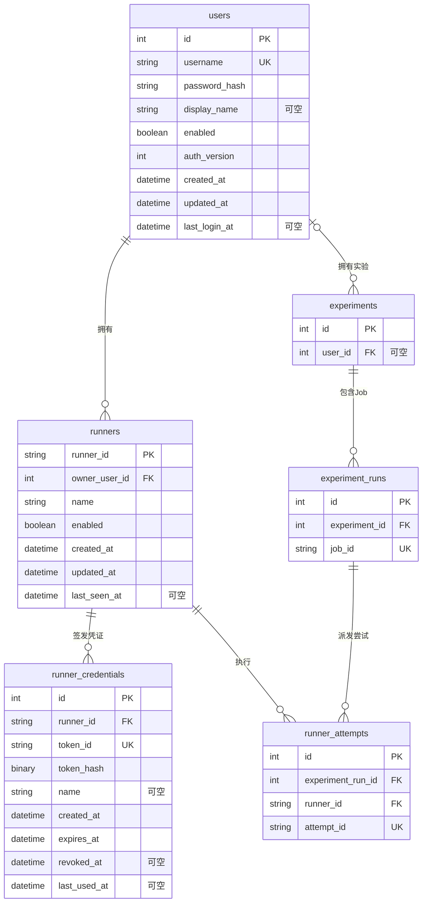

# 用户与 Runner 鉴权数据设计

最新接口已简化为 Runner 与凭证一对一、创建时签发、删除后重建，不再开放凭证轮换；见 [接口文档](api/登录鉴权与Runner管理.md)。下文保留已实现模型的说明；runner_id 唯一约束和 Runner.deleted_at 尚待后续 ORM 调整。

本阶段新增三张 PostgreSQL 表：`users`、`runners`、`runner_credentials`。
对应 ORM 位于 `evalforge/db/orm/auth.py`，统一从 `evalforge.db.models` 导入。
账号注册、登录、浏览器会话和密码验证已实现，见 [鉴权服务](server-auth.md)。Runner 凭证签发 / 验证、Runner 会话和 WSS 接口尚未实现，也未执行真实 PostgreSQL 建表。

## ER 图

图中的三张执行表仅展示关联字段；完整结构见 [ORM 说明](orm.md)。

## users：用户账号

| 字段 | PostgreSQL 类型 | 可空 | 用途 / 约束 |
| --- | --- | --- | --- |
| id | INTEGER | 否 | 内部主键 |
| username | VARCHAR | 否 | 唯一、非空白；登录名标准化由后续用户服务在写入前完成 |
| password_hash | VARCHAR | 否 | 非空白；保存 Argon2id 编码摘要，含盐和参数；ORM 不实现密码算法或校验编码格式 |
| display_name | VARCHAR | 是 | 显示名称 |
| enabled | BOOLEAN | 否 | 默认 true；账号是否启用 |
| auth_version | INTEGER | 否 | 默认 1，必须 > 0；浏览器登录会话失效版本，不自动撤销 Runner 凭证 |
| created_at | TIMESTAMPTZ | 否 | 默认数据库当前时间 |
| updated_at | TIMESTAMPTZ | 否 | 默认当前时间，ORM 更新时维护 |
| last_login_at | TIMESTAMPTZ | 是 | 最近成功登录时间，由登录服务写入 |

## runners：客户端身份

| 字段 | PostgreSQL 类型 | 可空 | 用途 / 约束 |
| --- | --- | --- | --- |
| runner_id | VARCHAR | 否 | 主键、非空白；ORM 插入时默认生成 UUID 字符串，是身份编号，不是秘密 |
| owner_user_id | INTEGER | 否 | FK → users.id，RESTRICT；有索引；标记所属用户 |
| name | VARCHAR | 否 | 非空白；例如“我的开发机”，不要求全局唯一 |
| enabled | BOOLEAN | 否 | 默认 true；是否允许该 Runner 连接、接任务 |
| created_at | TIMESTAMPTZ | 否 | 默认数据库当前时间 |
| updated_at | TIMESTAMPTZ | 否 | 默认当前时间，ORM 更新时维护 |
| last_seen_at | TIMESTAMPTZ | 是 | 最近观测时间，可低频更新；不能单独用它判断在线 |

Runner 的身份跨重启、重连保持稳定；一个 Runner 可保留多份凭证，但只允许一个当前有效连接，后者由会话层实现。

## runner_credentials：客户端访问凭证

| 字段 | PostgreSQL 类型 | 可空 | 用途 / 约束 |
| --- | --- | --- | --- |
| id | INTEGER | 否 | 内部主键，供会话标记所使用的凭证 |
| runner_id | VARCHAR | 否 | FK → runners.runner_id，RESTRICT；有索引 |
| token_id | VARCHAR | 否 | 唯一、非空白；公开查询标识，ORM 插入时默认生成 UUID hex |
| token_hash | BYTEA | 否 | 随机 secret 的 SHA-256 摘要，数据库检查长度为 32 字节；不存原始 Token |
| name | VARCHAR | 是 | 凭证备注，例如“首次创建”“轮换凭证” |
| created_at | TIMESTAMPTZ | 否 | 签发时间；ORM 默认当前 UTC 时间，数据库也有当前时间默认值 |
| expires_at | TIMESTAMPTZ | 否 | 必须晚于 created_at；ORM 默认签发后十个日历年，允许显式指定 |
| revoked_at | TIMESTAMPTZ | 是 | 撤销时间；非空时必须不早于 created_at |
| last_used_at | TIMESTAMPTZ | 是 | 最近成功凭证认证时间；更新它不延长有效期 |

到期默认值是 SQLAlchemy 插入默认值，不是数据库的十年默认表达式。原生 SQL 写入必须显式提供 expires_at；2028-02-29 签发时默认到期为 2038-02-28。ORM 默认 ID 和到期时间在插入 / flush 时产生，构造对象时尚未生成。

## 创建和验证规则

产品流程为“创建 Runner → 自动签发一份默认十年凭证 → 展示客户端配置”。
后续创建服务应在同一事务中插入 Runner 和凭证；ORM 不通过事件或关系隐式签发 Token。

Token 形式：`efr.<token_id>.<随机 secret>`。secret 至少使用 32 个密码学安全随机字节，再编码为 URL-safe 字符串；完整 Token 仅签发时展示，客户端本地保存。
验证服务按 token_id 查询后，计算 secret 的 SHA-256 并做恒定时间比较，同时检查：

- 当前时间 < expires_at，且 revoked_at 为空。
- Runner 与所属用户均 enabled。
- 凭证仅用于 Runner 接口；浏览器登录凭证另行管理，不能混用。

账号禁用、Runner 禁用、凭证到期或撤销时，需要关闭受影响的现有连接；不是仅在握手时检查一次。
浏览器普通退出或登录过期，不影响 Runner 连接。“重置凭证”由服务事务撤销旧凭证、签发新凭证，并使旧连接失效。

## 关联、删除与实现边界

- 新增四个有索引的外键：runners.owner_user_id、runner_credentials.runner_id、runner_attempts.runner_id、experiments.user_id。
- 前三个为 RESTRICT，防止误删身份时丢失凭证或派发历史；日常使用 enabled / revoked_at 停用。凭证记录本身不代表自动允许或拒绝连接，需要鉴权服务判断。
- experiments.user_id 保留可空和 SET NULL 删除语义；没有 Runner 引用的用户被删除后，实验仍保留。
- Dataset、Evaluator 等原有 user_id 暂缓外键保持原样，不在本次扩展范围内；评分表不改动。
- 派发时必须检查 Experiment.user_id == Runner.owner_user_id；两个外键并不能自动保证属于同一用户。
- 浏览器登录会话、Runner 有效会话注册表计划放 Redis；实际 WebSocket 对象留在云端进程内存，不建这两类 PostgreSQL 会话表。
- 浏览器鉴权已实现 auth_version 比较、用户名标准化、Argon2id 密码验证及 Redis 会话失效；Runner 的创建 / 删除与授权后续实现，不开放凭证重置接口。

已有数据库需先处理孤立的 experiments.user_id / runner_attempts.runner_id，再通过迁移添加外键。create_all 不会升级已有表；本次未生成或执行正式迁移。

## 验证

新增 8 项模型测试，使用内存 SQLite 实际验证默认值、十年与闰日到期、凭证轮换记录、唯一性、外键、摘要长度、时间约束及历史保护；另编译 PostgreSQL DDL 验证 BYTEA / TIMESTAMPTZ。
云端全量 79 项测试：77 项通过，2 项因没有真实 PostgreSQL / Redis 实例跳过。这不等于已验证实际登录或 WSS 鉴权。
临时将到期约束的 > 改为 >= 后，等于签发时间的边界测试按预期失败；已恢复严格约束。
