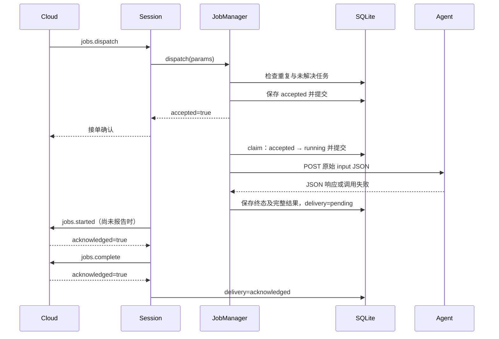

# 单 Job 正常执行链路（第二步）

本阶段接通已有会话、SQLite 仓储和 HTTP 调用器。客户端同时执行一个 Job，不保存待执行队列。

## 代码分工

| 文件 | 职责 |
| --- | --- |
| `client/evalforge_client/job_manager.py` | 校验派发、去重、容量、启动执行协程、保存最终结果 |
| `client/evalforge_client/attempts.py` | accepted、claim running、finish pending、acknowledge；沿用现有实现 |
| `client/evalforge_client/http_executor.py` | 调用本地预配置 Agent，返回原始 JSON、耗时、HTTP 状态与错误 |
| `client/evalforge_client/session.py` | ready 门禁、started/complete RPC 与 ACK、重连同步 |
| `client/evalforge_client/app.py` | 进程级创建与关闭组件；每次连接创建新 Session |

## 正常链路

执行在独立 asyncio.Task 中，不等待云端收到接单响应才启动。会话每 0.5 秒扫描一次：长任务运行期间可发送 started；快速完成时也先发送 started、再 complete。started 是开始事实的通知，其 ACK 不作为调用 Agent 的前置条件。

## 接单规则

`dispatch()` 用同一把 asyncio.Lock 协调去重、容量和持久化，事务中不等待网络。

1. 参数必须包含 job_id、attempt_id、agent_target_id、example_id、input、timeout_seconds；未知字段、非法 JSON 或非正有限超时返回 JSON-RPC -32602。
2. 已有同一 job_id + attempt_id：参数相同返回 accepted=true，不重做 running/终态/unknown；参数不同返回 attempt_conflict。
3. 新任务的本地目标不存在：返回 target_not_found。
4. 正在执行，或数据库存在 accepted/running/unknown：返回 busy，不保存被拒绝任务。
5. 空闲时先提交 accepted，再创建执行协程并确认接单。

只有 claim 成功才能发 HTTP。完成后不论成功还是调用失败，都通过 finish 原子保存终态和 pending 结果。已完成但未 ACK 的记录不占执行容量。

## 生命周期与失败

- app 退出顺序：JobManager → HttpExecutor → ClientDatabase。断线只结束 Session，不取消 Job 协程。
- HTTP 失败保存 failed，错误来自 HTTP 层；意外执行异常保存脱敏的 executor_error，不重试 Agent。
- claim/finish 等持久化发生意外错误时，记录日志并停止接收新任务，不能虚构已经保存结果。
- 退出中断 HTTP 等待时保留 running；下次启动转为 unknown，禁止自动重执行。
- accepted 只在云端 sync 明确 continue 后恢复执行；仍存活的 running 不重新调用 Agent。
- started 或 complete 未获得严格 acknowledged=true，结束当前会话，结果保留，重连对账；不因此重新执行 Agent。

## 当前边界与阅读顺序

先读 `JobManager.dispatch → _schedule → _execute`，再读 `RunnerSession._serve_ready → _upload`，最后看 app 的资源管理。

运行中取消及断线/重启恢复已补齐，见 [取消与恢复](取消与恢复.md)。只停止客户端 HTTP 等待；已获得的结果继续落盘。unknown 的最终裁定和真实 WSS 验证继续列在 [TODO](TODO.md)。

验证入口：在 client 目录运行 `.\.venv\Scripts\python.exe -X utf8 -W error -m unittest discover -s tests -v`。
新增测试见 `tests/test_job_lifecycle.py`，包括单 Job、重复派发、并发 busy、HTTP 失败、持久化故障，以及真实本机 WebSocket + HTTP + SQLite ACK 的端到端链路。

2026-11-02 验证：客户端全部 75 项测试在 `-W error` 下通过，其中本阶段新增 12 项；started ACK 拒绝、非法确认值和超时均保留结果且不发送 complete。
临时反转成功/失败判断后，失败结果测试按预期报错；恢复原文件后 12 项 Job 测试再次通过。代码复查无阻塞问题，compileall 与 git diff --check 通过。
