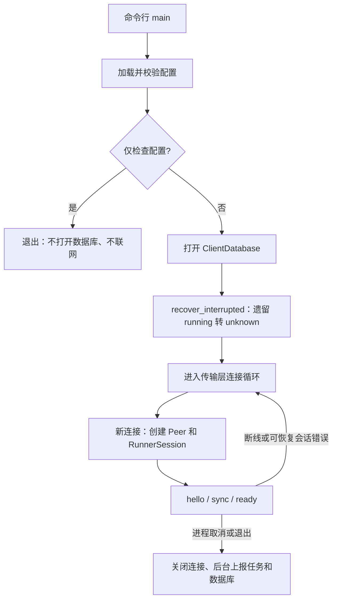
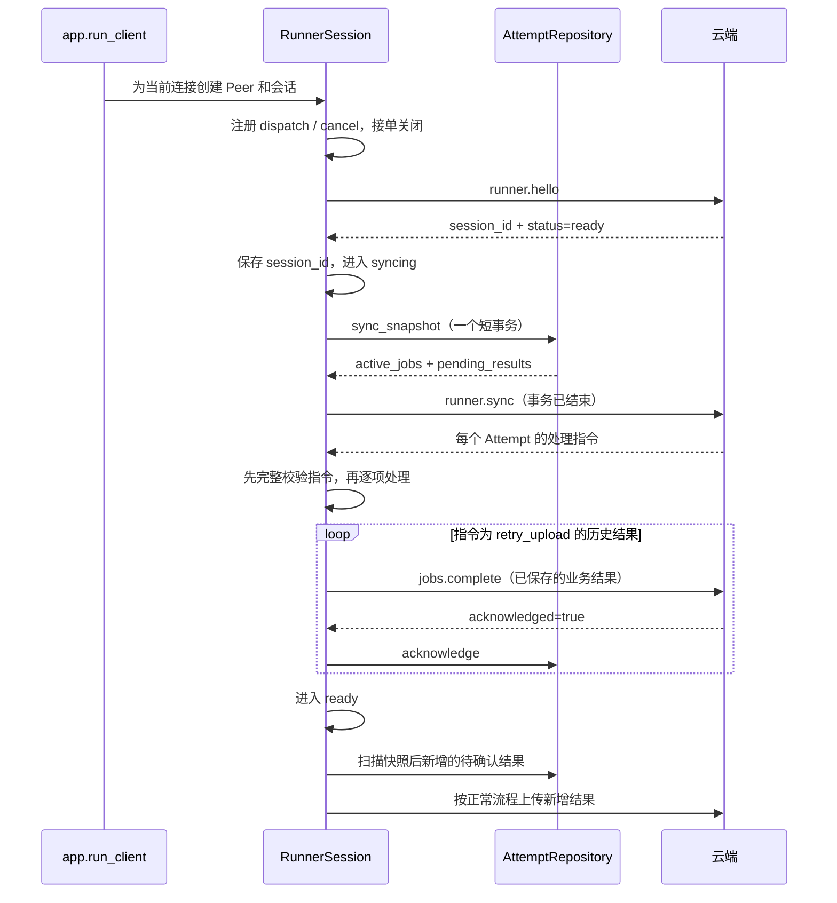

# 客户端会话层：核心链路与代码阅读指南

这份文档说明当前实现的启动、hello/sync、结果上报和断线重连，便于回看代码时先掌握整体流程。

当前客户端可以常驻运行并与符合协议的云端建立会话。JobManager 和 Agent HTTP 调用尚未实现，因此能同步已有记录，但不会接受新的实际执行任务。当前验证使用本机模拟云端，尚未验证真实 WSS Cloud 部署。

## 1. 先理解三个生命周期

| 生命周期 | 包含什么 | 什么时候结束 |
| --- | --- | --- |
| 进程 | 配置、数据库、Attempt 仓储、后续接入的 JobManager | 用户退出或进程异常结束 |
| 连接 / 会话 | WebSocket、JsonRpcPeer、RunnerSession、当前 session_id | 当前连接断开或同步失败 |
| Attempt | 某次任务执行尝试及其结果 | 记录跨连接和进程重启保留，清理策略后续再定 |

网络断线只重建连接和会话，不清空数据库，不执行一次新的启动恢复，也不应终止后续 JobManager 独立管理的执行任务。

这里的 RunnerSession 是客户端与云端的业务会话，与 SQLAlchemy 的数据库 AsyncSession 是两个不同概念。

## 2. 从哪里读代码

| 顺序 | 入口 | 主要看什么 |
| --- | --- | --- |
| 1 | [`__main__.py`](../../client/evalforge_client/__main__.py) 的 `main()` | 命令行、配置检查、启动、退出和脱敏错误输出 |
| 2 | [`config.py`](../../client/evalforge_client/config.py) 的 `ClientConfig.load()` | JSON 配置、环境凭据、状态库路径和参数校验 |
| 3 | [`app.py`](../../client/evalforge_client/app.py) 的 `run_client()` | 进程恢复一次，之后不断建立新的连接和会话 |
| 4 | [`session.py`](../../client/evalforge_client/session.py) 的 `RunnerSession.run()` | 注册入口、hello、sync、应用指令、进入 ready |
| 5 | 同文件 `_validate_actions()`、`_upload()`、`_serve_ready()` | 同步校验、确认后落盘、ready 后扫描新增结果 |
| 6 | [`attempts.py`](../../client/evalforge_client/attempts.py) 的 `sync_snapshot()` | 同一个数据库事务内生成同步快照 |
| 7 | [`tests/test_session.py`](../../client/tests/test_session.py) | 同步竞态、结果确认、启动恢复和真实回环重连 |

数据库字段与状态约束见 [表设计](表设计.md)，通信字段见 [协议草案](../EvalForge_Runner_JSON-RPC_Protocol_v1.md)。

## 3. 进程启动链路：恢复只发生一次



`run_client()` 在连接循环外创建数据库和仓储，并调用一次 `recover_interrupted()`。

- `accepted` 保留，表示还没进入 HTTP 调用阶段。
- 遗留 `running` 转为 `unknown`，原因记为 `client_restarted`。
- 已有终态及待确认结果保留。
- 重连时不调用恢复，仍然存活的执行协程由后续 JobManager 跟踪。

进程独占锁按约定暂不做，已记录为 [TODO](TODO.md)。当前由使用者保证同一状态库只启动一个 Runner；这不是一个已经具备多进程互斥保证的实现。

## 4. 配置加载

配置文件至少包含：

| 字段 | 作用 |
| --- | --- |
| `cloud_url` | 云端 WSS 地址 |
| `runner_id` | Runner 身份标识，真正鉴权仍由云端验证凭据 |
| `token_env` | 存放凭据的环境变量名称，配置文件不保存明文 Token |
| `state_path` | SQLite 文件路径；相对路径以配置文件所在目录为基准 |
| `targets` | 本地 Agent 目标配置，当前只校验，不发起 HTTP 调用 |
| `rpc_timeout` | RPC 等待超时，默认 30 秒 |
| `allow_insecure_localhost` | 默认 false；显式开启后允许本机 loopback WS 测试 |

ClientConfig 隐藏 Token、云端 URL 和目标配置的 repr。传输参数校验复用 WebSocketTransport，生产连接要求 WSS。

`--check-config` 校验配置和凭据是否存在，不检查真实网络连通性、云端鉴权结果或 Agent 可用性。

## 5. 单连接会话链路



### 5.1 hello 并不直接开放接单

发送 Runner ID、客户端版本、能力和最大并发数。当前尚无执行器，`capabilities=[]`，`max_concurrent_jobs=1` 表示 V1 容量约定，不代表已有执行能力。

响应必须包含非空字符串 `session_id` 和 `status="ready"`。通过校验后只进入 syncing；这个 ready 是握手结果，不是客户端已经同步完成。

`session_id` 只在内存保存，当前连接结束后清空。下一条连接重新 hello，不恢复旧会话对象。

### 5.2 sync 快照必须来自同一个事务

仓储一次查询读取：

- `execution_status` 为 accepted、running、unknown 的未解决尝试。
- `delivery_status=pending` 的最终结果。

这样不会因任务在两次查询之间完成，造成两份列表中的遗漏或重复。拿到快照立即结束事务，再等待 RPC；数据库事务不包住网络调用。

active_jobs 上报 ID 和本地执行状态；pending_results 上报完整的最终业务结果，不包含 JSON-RPC 请求 ID。

### 5.3 指令先完整校验，再应用

当前要求云端对快照中的每个 Attempt 返回一条指令：不能遗漏、重复或引用未知 ID。

| 指令 | 处理方式 |
| --- | --- |
| `continue` | 未结束的 accepted/running 交给已接入的 SessionJobs.resume；unknown 不允许通过该指令重新执行 |
| `cancel` | 保存取消意图；accepted 可以直接生成执行前取消结果；running 交给 SessionJobs.cancel；unknown 保留未知事实 |
| `retry_upload` | 只允许用于快照中已存在的待确认结果，上传保存的 result_json |

历史 pending 必须明确获得 retry_upload；不能把 continue 当作云端已确认保存。discard 暂不支持。

应用每条指令前重新读取该 Attempt。如果快照中的 running 已在同步期间完成，就跳过旧 continue/cancel，保留最终结果，之后在 ready 阶段正常上报。

完整校验不意味着多条同步指令在云端和本地之间构成原子事务。若处理一部分后断线，已提交的事实保留，下一次连接重新生成快照、重新对账。

## 6. 两类待确认结果必须分开

`historical` 是生成快照时，pending 记录的 `(job_id, attempt_id)` 集合，只存在本次会话内存中。

| 结果来源 | 什么时候上传 |
| --- | --- |
| 快照中已经存在的 pending | 等云端 retry_upload 指令，作为同步的一部分处理 |
| 快照后、同步期间刚生成的结果 | 等会话 ready 后正常上传，不为此再 sync 一轮 |
| ready 期间新完成的结果 | 正常上传 |

`_serve_ready()` 启动两个协程：等待 Peer 关闭，以及扫描新增结果。上传器进入 ready 后立即查询 SQLite，之后每 0.5 秒检查一次，避免依赖瞬时内存通知而漏发。

历史集合中的条目不会被该扫描器擅自上传。它们在同步期间按云端指令处理，确认成功后不再属于 pending。

### 结果确认的边界

```text
本地已有最终结果，delivery_status=pending
  → 调用 jobs.complete
  → 收到严格的 acknowledged=true
  → 本地 acknowledge() 提交
```

返回 false、缺少确认、超时或断线，都保留本地 pending。客户端不因此修改最终执行结果，更不会重新调用 Agent。若云端已保存但确认丢失，下次 sync 后幂等补交同一份结果。

## 7. ready 与接单不是一回事

入站 RPC 方法在 hello 前注册，但方法本身有门禁：

| 条件 | jobs.dispatch 返回 |
| --- | --- |
| 尚未 ready | `accepted=false, reason=not_ready` |
| 没有接入执行层 | `accepted=false, reason=executor_unavailable` |
| 存在未解决 Attempt | `accepted=false, reason=busy` |
| 满足上述条件 | 交给 SessionJobs.dispatch，由 JobManager 最终原子管理容量和持久化接收 |

因此 unknown 即使参与对账后会话进入 ready，也会阻止新派发。当前命令行启动没有注入执行层，所有实际派发都会被明确拒绝。

SessionJobs 是后续 JobManager 的接口，不是已经实现的执行器。resume/cancel 必须快速完成协调，把真正执行放在独立于连接的任务中。

## 8. 断线、异常与退出

`RunnerSession.run()` 的 finally 总会将 phase 恢复为 disconnected 并清空 session_id。

app 对 TransportClosed、TimeoutError、SessionError、RpcError、RpcProtocolError 结束当前会话，再使用传输层退避重连。传输层认定为永久的握手错误，例如认证拒绝，不会无限重试；其他未归类异常向进程入口传播并以非零状态退出。

会话错误日志不输出远端错误详情，避免带出业务内容或凭据。

ready 阶段两个后台协程有任一结束，就取消并等待另一个。取消进程时通过上下文退出关闭 Peer、WebSocket 迭代器和数据库。

## 9. 如何运行

在 EvalForge/client 目录复制 config.example.json 为 client-config.json，并填写真实配置：

```powershell
$env:EVALFORGE_RUNNER_TOKEN = "你的 Runner 凭据"
.\.venv\Scripts\python.exe -m evalforge_client --config client-config.json --check-config
.\.venv\Scripts\python.exe -m evalforge_client --config client-config.json
```

日志出现 `Runner session ready` 表示本轮 hello/sync 已完成，不代表真实任务执行能力已就绪。Ctrl+C 退出。

## 10. 本次验证与后续边界

客户端完整测试共 49 项，在 `-W error` 下通过，依赖检查通过。新增会话测试覆盖：

- 空库 hello/sync 顺序、同步前门禁、无执行器拒绝派发。
- 历史结果按指令补交，确认成功才更新数据库。
- 同步期间任务完成，ready 后上传，旧指令不触发重新执行。
- 缺失、未知、不支持或矛盾的指令导致同步失败，保持历史结果。
- 无效 hello、超时、结果未确认时清理会话或保留 pending。
- unknown 不接受 continue，取消只保留意图而不伪造已停止。
- 真实本机 WebSocket 重连，启动恢复只调用一次。
- 配置相对路径、环境凭据和 repr 脱敏。

尚未实现：JobManager、Agent HTTP 调用、进程独占锁、状态库身份绑定和 unknown 的进一步裁定。真实 WSS 与云端多实例会话接管仍需后续集成验证。
