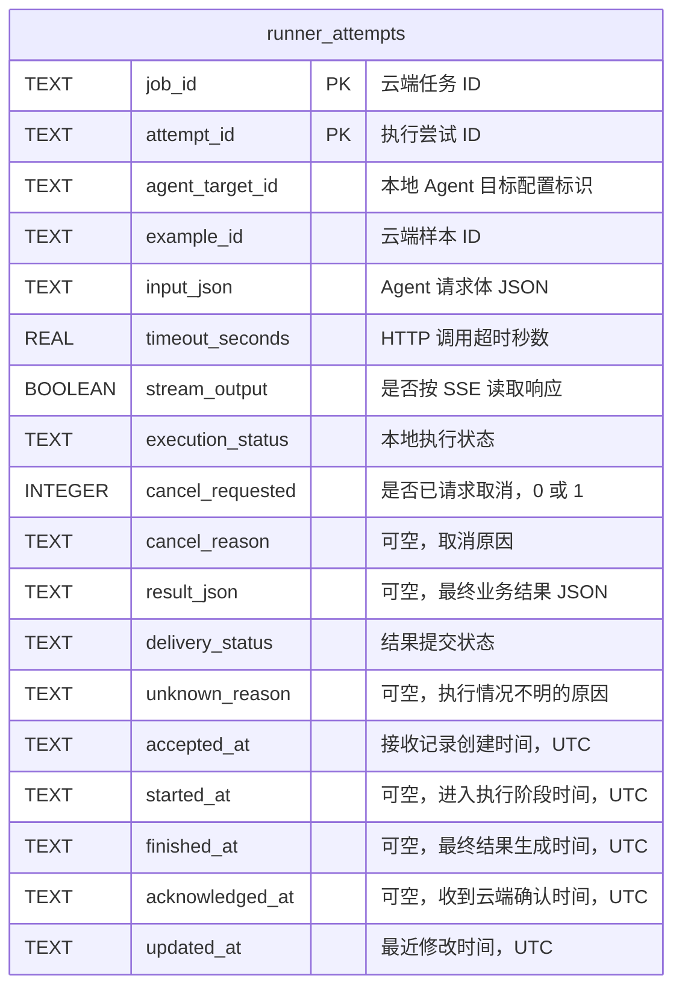

# 客户端 SQLite 表设计（V1）

本文记录会话层与 Job 管理层共用的本地持久化设计。数据库层已实现：`models.py` 定义 ORM，`database.py` 管理异步数据库与版本化建表，`attempts.py` 提供仓储。`store.py` 保留原生 SQL 基础接口。

V1 使用一张业务表 `runner_attempts`，保存已接收的执行尝试、最终结果及结果提交状态。按后续确认采用 SQLAlchemy 异步 ORM + aiosqlite，不引入独立结果队列表。

## 1. 概念与范围

| 概念 | 含义 |
| --- | --- |
| Example | 数据集中的一条测试样本；参考答案留在云端 |
| Job | 某次实验中，对一条 Example 的测试任务；同一 Example 可在不同实验中对应不同 Job |
| Attempt | 为完成某个 Job 发起的一次执行尝试；可能在实际调用 Agent 前中断 |
| `agent_target_id` | 被测 Agent 在客户端本地配置中的标识，用于查找 HTTP 地址与调用配置 |
| Session | Runner 与 Cloud 当前连接上的业务会话，重连时重新建立 |

一行记录对应一个 `(job_id, attempt_id)`。网络重连、RPC 重试和结果重传不创建新的 Attempt；明确发起新的执行尝试时才使用新的 `attempt_id`。更换 Attempt ID 本身不能消除 Agent 的重复副作用。

客户端仅存储执行输入与实际结果，不保存数据集参考答案。V1 同时只执行一个 Job。

## 2. Mermaid ER 图

图中只展示实际计划落地的客户端表。`job_id`、`example_id` 和 `agent_target_id` 是云端或配置关联标识，不是本地数据库外键；两个 `PK` 字段组成联合主键。



## 3. 字段定义

| 字段 | SQLite 类型 | 可空 | 默认值 / 约束 | 用途 |
| --- | --- | --- | --- | --- |
| `job_id` | TEXT | 否 | 联合主键，非空字符串 | 标识云端测试任务 |
| `attempt_id` | TEXT | 否 | 联合主键，非空字符串 | 标识本次执行尝试，用于派发去重和结果归属 |
| `agent_target_id` | TEXT | 否 | 非空字符串 | 从本地配置查找允许调用的 Agent 目标 |
| `example_id` | TEXT | 否 | 非空字符串 | 关联云端测试样本 |
| `input_json` | TEXT | 否 | 合法 JSON | 保存传给 Agent 的请求体 |
| `timeout_seconds` | REAL | 否 | 有限正数，应用层校验 | 保存本次调用超时配置 |
| `stream_output` | BOOLEAN | 否 | 默认 0，CHECK：0 / 1 | 持久化流式模式，纳入重复派发校验 |
| `execution_status` | TEXT | 否 | 初始为 `accepted`，限制取值 | 描述本地执行进度或最终状态 |
| `cancel_requested` | INTEGER | 否 | 默认 0，CHECK：0 / 1 | 持久化取消意图，不代表取消已生效 |
| `cancel_reason` | TEXT | 是 | 默认 NULL | 保存取消原因 |
| `result_json` | TEXT | 是 | 默认 NULL；非空时为合法 JSON 对象 | 保存准备提交的完整最终结果 |
| `delivery_status` | TEXT | 否 | 初始为 `not_ready`，限制取值 | 区分无结果、待确认和已确认 |
| `unknown_reason` | TEXT | 是 | 默认 NULL | 如 `client_restarted`，说明为何无法确认执行情况 |
| `accepted_at` | TEXT | 否 | 创建接收记录时写入 | 表示本地接收时间；持久化成功以事务提交为准 |
| `started_at` | TEXT | 是 | 默认 NULL | 表示进入“可能调用 Agent”的阶段，不保证 HTTP 已发出 |
| `finished_at` | TEXT | 是 | 默认 NULL | 表示本地最终结果生成时间，不代表远端副作用一定结束 |
| `acknowledged_at` | TEXT | 是 | 默认 NULL | 表示客户端收到云端持久化确认的时间 |
| `updated_at` | TEXT | 否 | 创建及修改记录时维护 | 用于排查与状态追踪 |

时间统一使用带 UTC 标识的 ISO 8601 字符串。耗时由执行过程的单调时钟测量后写入结果，不用墙上时钟相减推算。

本次不增加废弃标记或废弃时间字段；相关业务确实需要时再设计。

## 4. 执行状态与结果提交状态

### 4.1 `execution_status`

| 状态 | 含义 |
| --- | --- |
| `accepted` | 已持久化接收，尚未进入 HTTP 调用阶段 |
| `running` | 已持久化执行标记，可能已经调用 Agent；不能仅凭记录断言 Agent 正在运行 |
| `unknown` | 无法确认执行情况，不自动重新调用 Agent |
| `succeeded` | 已生成成功结果 |
| `failed` | 已生成失败结果 |
| `cancelled` | 客户端已结束本次执行并生成取消结果 |

`succeeded`、`failed`、`cancelled` 是本地终态。HTTP 超时或停止等待不证明 Agent 未执行；失败或取消结果应如实说明已知情况，不能承诺远端副作用已撤销。

`cancel_requested` 是与执行状态独立的取消意图。收到取消请求时可以先置为 1，但实际结果仍可能是成功、失败或取消。

### 4.2 `delivery_status`

| 状态 | 含义 |
| --- | --- |
| `not_ready` | 尚无最终结果 |
| `pending` | 最终结果已落盘，等待云端确认 |
| `acknowledged` | 云端已确认持久化 |

例如，`execution_status=succeeded` 且 `delivery_status=pending` 表示已执行成功、结果尚未确认，后续只重传结果。

`unknown` 保留在本地历史中，释放接单容量。重连时云端会把快照中缺失的活跃 Attempt 标记为 unknown，调度继续处理后续 Job。

### 4.3 一致性约束

- 联合主键为 `(job_id, attempt_id)`，两个字段均显式声明 NOT NULL。
- `execution_status`、`delivery_status` 使用 CHECK 限制取值。
- 非终态对应 `result_json IS NULL`、`delivery_status=not_ready`、`finished_at IS NULL`。
- 终态对应非空 `result_json`、非空 `finished_at`，提交状态为 `pending` 或 `acknowledged`。
- `acknowledged_at` 仅在 `delivery_status=acknowledged` 时非空。
- `result_json` 内的 Job ID、Attempt ID、最终状态必须与本行一致，由写入逻辑校验。
- 同一 Attempt 的最终结果生成后不被重传逻辑修改，也不因一次上报失败而改回执行中。

## 5. 最终结果格式

`result_json` 保存准备发送给 `jobs.complete` 的业务参数，不保存 JSON-RPC 请求 ID 或整个 RPC 消息封装。

```json
{
  "job_id": "job-01",
  "attempt_id": "attempt-01",
  "status": "succeeded",
  "output": {"reply": "订单尚未发货"},
  "duration_ms": 850,
  "http_status": 200,
  "error": null
}
```

失败时 `error` 保存结构化错误；没有收到 HTTP 响应时 `http_status` 可以为 null。重传使用同一份业务结果，RPC ID 可以重新生成。

## 6. 原子更新与执行顺序

| 时机 | 同一个本地事务中完成的操作 | 事务提交后的操作 |
| --- | --- | --- |
| 接收派发 | 插入参数，设置 `accepted`、`not_ready` 和时间 | 返回 `accepted=true` |
| 准备执行 | 条件更新 `accepted → running`，设置 `started_at` | 只有成功取得执行权的协程才能发起 HTTP |
| 收到取消指令 | 保存取消意图和原因 | 通知 JobManager 协调取消 |
| 执行结束 | 同时写入终态、完整结果、`finished_at`，设置 `pending` | 调用 `jobs.complete` |
| 收到云端确认 | 将 `pending` 改为 `acknowledged`，记录确认时间 | 保留记录供去重，后续再设计清理策略 |
| 客户端进程启动恢复 | 将遗留 `running` 改为 `unknown`，记录原因和更新时间 | 建立连接并执行 hello / sync |

所有网络等待均放在 SQLite 事务外；事务只执行短 SQL 操作。

执行权更新必须带条件 `WHERE execution_status = 'accepted'` 并检查更新行数，不能先查询状态，再无条件写入并执行。重复派发命中同一主键时核对参数，参数不同则拒绝，不覆盖原记录。JSON 参数比较应按内容语义进行，而非直接比较对象键顺序或字符串空格。

## 7. 崩溃恢复与重连

顺序固定为：

```text
接收并持久化 accepted
  → 持久化 running，并等待事务提交成功
  → 发起 Agent HTTP 调用
  → 持久化最终结果及 pending
  → 提交结果到云端
  → 收到确认后持久化 acknowledged
```

SQLite 事务与 HTTP 调用无法成为一个原子操作。先写状态再调用，可以避免“已调用但仍记为 accepted”；代价是写入 running 后、HTTP 发出前崩溃，也只能按执行情况不明处理。

| 恢复场景 | 处理 |
| --- | --- |
| 新进程看到 `accepted` | 保留；按约定尚未进入调用阶段，等待同步后决定是否执行 |
| 新进程看到 `running` | 改为 `unknown`，原因记为 `client_restarted`，不自动重跑 |
| 原进程仅网络断线，执行协程仍存活 | 不做启动恢复，继续跟踪任务；任务可能在离线期间完成并生成待确认结果 |
| 已有最终结果且为 `pending` | 保留结果，重连同步后上报，不重新调用 Agent |
| 已有 `unknown` 或 `acknowledged` | 保留，不自动执行 |

启动恢复仅在新进程初始化时执行，不在每次打开连接或网络重连时执行。同一数据库文件必须由一个 Runner 进程管理。按后续确认，进程独占锁暂记 TODO，本轮不实现，当前由使用者保证不重复启动。

这里的“最多一次”限定为客户端不对同一 Attempt 自动重复发起 HTTP 调用。若希望不确定情况下还能安全重试，需要 Agent 提供幂等或执行查询能力。

## 8. 同步查询与不入库的内容

会话层从本表读取两类事实：

1. 活跃的执行尝试包含 `accepted` 和 `running`。
2. 待确认结果：`delivery_status=pending` 的最终结果。

V1 数据量较小时，联合主键足以满足按 Attempt 查找和去重；额外状态索引可随查询规模增加再引入。

| 内容 | 保存位置 |
| --- | --- |
| `runner_id`、云端地址、目标映射、凭据来源 | 本地配置文件 / 环境变量 |
| 当前 `session_id`、连接、RPC 等待对象 | 内存，每次连接重新建立 |
| 同步阶段、接单开关 | 内存；同步成功后结合任务容量计算 |
| 正在运行的协程 | 内存，不能从数据库还原为原协程 |

数据库文件固定服务于同一个 Runner 和云端环境，不切换身份后直接同步旧记录。当前不增加身份元数据表，身份绑定检查后续在配置与启动设计中明确。数据库结构版本先使用 `PRAGMA user_version` 管理。

## 9. 与现有代码及协议的衔接

- 异步 ORM 数据库：[`database.py`](../../client/evalforge_client/database.py)，新库创建 V2 表；已有 V1 库在启动事务内增加 `stream_output`，旧行默认 0，保留待上传结果。未知版本或无版本的同名表拒绝打开。
- ORM 模型：[`models.py`](../../client/evalforge_client/models.py)。
- Attempt 仓储：[`attempts.py`](../../client/evalforge_client/attempts.py)，支持接收去重、条件取得执行权、取消意图、完成及确认、显式恢复和同步查询。
- 原生 SQL 基础设施：[`store.py`](../../client/evalforge_client/store.py)，保持不自动创建业务表的原接口；不要与 ORM 层并行管理同一文件。
- 会话层实现入口：[`session.py`](../../client/evalforge_client/session.py)，已实现 hello/sync、门禁与结果上传。
- Job 管理入口：[`job_manager.py`](../../client/evalforge_client/job_manager.py)，目前占位。
- 通信协议：[`EvalForge_Runner_JSON-RPC_Protocol_v1.md`](../EvalForge_Runner_JSON-RPC_Protocol_v1.md)。

派发字段使用已确认的新名称 `agent_target_id`。app 在进程启动时显式恢复一次，数据库打开本身不触发恢复；Job 执行尚未接入，进程独占锁和身份绑定为 TODO。
