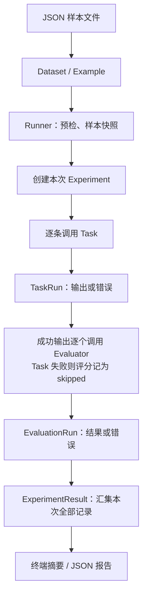

# 内存中的 Experiment 标准流程

本阶段只组装执行链路。读取本地 JSON，在内存中运行，最后导出报告；不连接数据库。

## 怎么运行、怎么替换

在 EvalForge 根目录执行：

```powershell
.\.venv\Scripts\python.exe -m examples.run_pipeline
```

默认读取 `examples/text_cases.json`，输出 `results/pipeline.json`。
可用 `--dataset 路径 --output 路径` 更换文件。

`examples/run_pipeline.py` 的两个普通函数是当前占位：

- `placeholder_task(input)` 返回 `{"received": input}`，验证输入进入任务并产生输出。
- `placeholder_evaluator(output)` 返回 `EvaluationResult(label="placeholder", ...)`，验证评分步骤已执行。

占位评分不判断答案对错，因此 `scored = 0`、`mean_score = null`；`evaluated = 4` 表示四次评分调用成功。
需要真实逻辑时替换或 import 自己的函数，再传给 `run_experiment`。
原来的 `examples/run_demo.py` 保留，展示真实的文本处理与匹配评分。

## 元件和职责

| 元件 | 代码位置 | 当前职责 |
| --- | --- | --- |
| Dataset / Example | `evalforge/models.py`、`dataset.py` | 读取并校验样本，保存输入、参考答案、元数据 |
| Experiment | `evalforge/models.py` | 一次评测的 ID、名称、数据集名、Task 名、评分器名称与创建时间 |
| Task / Evaluator | `examples/run_pipeline.py` | 可替换的同步 Python 函数，直接交给 Runner |
| Runner | `evalforge/runner.py` | 预检签名、复制样本、创建 Experiment、分阶段执行、收集错误 |
| TaskRun | `evalforge/models.py` | 单条样本的实际输出或错误；通过 experiment_id 归属本次实验 |
| EvaluationRun | 同上 | 单个评分器的结果或错误；通过 task_run_id 关联具体 TaskRun |
| ExperimentResult | 同上 | 汇集 Experiment、TaskRun 列表、EvaluationRun 列表 |
| 输出层 | `evalforge/reporting.py` | 从 Result 计算摘要，并导出 JSON |

这些是内存数据对象，与 `evalforge/db/models.py` 的 ORM 类分开。没有增加存储接口、数据库迁移或配置服务。
Experiment 只记函数名称供阅读，名称不能还原函数代码，也不提供实验恢复能力。



## 关联关系与错误行为

```text
Experiment.id ← TaskRun.experiment_id
TaskRun.id    ← EvaluationRun.task_run_id
Example.id   ← TaskRun.example_id / EvaluationRun.example_id
```

每次调用 `run_experiment` 创建新的 UUID；同样的名称、数据、函数再次运行，仍是另一次 Experiment。
本阶段每条样本只执行一次，多个 Evaluator 分别生成评分记录。

先执行完全部 Task，再开始评分。Task 异常写入对应 TaskRun，其评分记为 skipped；
Evaluator 异常只影响当前评分记录，其他评分继续。零分是正常评分，不等于异常。
签名和实验名称等配置错误在调用 Task 前报错。

报告顶层现在是 `experiment`、`task_runs`、`evaluation_runs`、`summary`。
`ExperimentResult` 的构造参数改为 Experiment 对象和两类记录；
原有 `result.experiment_name`、`result.dataset_name` 读取方式通过属性保留。
UUID 只用于本地关联，不是数据库主键，也没有实现 Dataset 版本管理。

## 参考 Phoenix 的哪里

以本地 Phoenix commit `14c193cfa` 为准：

- `packages/phoenix-client/src/phoenix/client/resources/experiments/__init__.py`：
  `Experiments.run_experiment` 先创建实验、执行 Task，再进入评分；
  `_build_evaluation_tasks` 将样本、具体运行记录、评分器组合起来。
- 同目录 `types.py`：`RanExperiment` 汇集实验与执行结果。
- 同目录 `evaluators.py`：按函数参数名绑定数据、统一评分返回值。

EvalForge 沿用这些职责边界。Phoenix 的 HTTP 读写、并发调度和 Tracing 没有引入本流程。
原有参数绑定、深拷贝隔离、评分规范化及错误处理继续复用，新增 Experiment 和记录关联。

## 建议阅读顺序

1. `examples/run_pipeline.py`：看入口和两个替换点。
2. `evalforge/models.py`：看一次实验与两类执行记录怎样关联。
3. `evalforge/runner.py`：看预检、Experiment 创建、Task 循环、Evaluator 循环。
4. `evalforge/reporting.py` 与 `results/pipeline.json`：对照实际报告。
5. `tests/test_pipeline.py`：看同名多次运行、错误关联、占位评分及无第三方依赖运行的验证。

## 本次验证（2026-10-29）

- 新增流程测试 6 项、原有执行链路回归测试 21 项，全部通过，使用 `-W error`。
- `python -S -X utf8 -m examples.run_pipeline` 实际运行成功：4 条 Task、4 次评分调用均成功，
  数值评分数为 0、均分为 null，报告已生成。
- `-S` 关闭 site-packages 加载，验证运行链路不依赖 SQLAlchemy、asyncpg 等第三方包。
- Windows 沙箱首次阻止测试读写系统临时目录；获得授权后在沙箱外复测通过，未调整执行逻辑。
- 本次没有修改数据库模块、ORM 或迁移，也没有运行数据库连接或建表操作。
