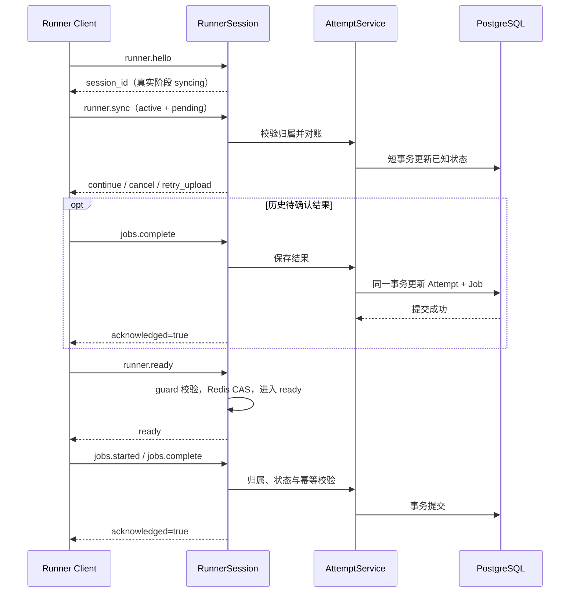

# Attempt 业务与同步

Runner 上报与重连对账由 AttemptService 处理。进程级 Scheduler 通过 DispatchService 领取 Job 并创建 Attempt。两条链路共用数据库状态。见 [当前架构](当前项目架构图解.md#10-进程级调度)。

## 代码分工

| 文件 | 职责 |
| --- | --- |
| `evalforge/server/schemas/attempts.py` | started、complete、sync、ready 参数校验 |
| `evalforge/server/services/attempts.py` | 归属校验、状态更新、事务、结果幂等与同步对账 |
| `evalforge/server/runner_sessions.py` | 串行处理会话事件、维护同步事实、调用状态机、记录数据库错误 |
| `evalforge/server/routes/runner_ws.py` | 注册 RPC 方法 |
| `client/evalforge_client/session.py` | 应用同步指令、补传历史结果、显式 ready 握手 |

## 正常链路

## 数据库操作

- `runner_attempts`：执行状态、开始上报时间、完整结果、结果接收时间、未知原因及同步产生的取消意图。
- `experiment_runs`：Job 状态、开始/结束时间、输出、结构化错误、耗时和 HTTP 状态。输出包装为 `{"task_output": 原始输出}`，支持 JSON null。
- 读取 `runners` 和 `experiments` 校验认证 Runner 与实验用户归属。V1 实验的最后一个 Job 进入终态时，同一事务将仍为 running 的实验更新为 completed。
- 每次操作使用独立短事务。按 Runner → Job → Attempt 加行锁；同 Runner 操作串行，终态重复结果只比较确认，冲突拒绝覆盖。
- `started` 不覆盖终态，也不把 unknown 当作确认仍在运行；sync 的当前 running 快照可以确认仍存活的执行。

## sync 与 ready

- 一个连接只成功处理一次 sync；校验整个快照，任一项目不合法则回滚。
- pending_results 不在 sync 中直接保存，统一返回 retry_upload；即使数据库已有相同结果，也重传并幂等确认。
- active accepted / running 按可信归属对账；已有取消意图或服务端终态返回 cancel，不据此伪造 cancelled 结果。
- 本地 unknown 返回 cancel，仅保留未知事实和取消意图，不重新执行，也不释放容量。
- 云端活跃 Attempt 未出现在客户端快照中：标记 unknown，原因 missing_from_client_snapshot。第一版不自动重试或人工裁决。
- 会话内存保存 sync_processed 与历史 pending_uploads；历史结果事务提交成功并确认会话仍有效后才移除，重连重建。
- ready 使用已有状态机：有效会话、sync 已处理、历史 pending 为空；Redis 条件更新成功后响应。重复 ready 幂等。
- active Job 不阻塞 ready，但继续占用执行容量。快照后产生的新结果可在 syncing（sync 已完成）或 ready 阶段提交。
- 客户端补传历史结果后先打开本地接单门禁，再请求 runner.ready，避免云端确认后立即派发被拒绝；握手失败会关闭本地门禁。

## 异常策略

- 数据库或本次业务操作超时：事务失败向上传播，由 RPC 业务入口记录一次脱敏 ERROR，返回 -32003。没有云端自动重试、Redis Outbox 或补偿队列。
- 预期业务拒绝返回 -32002；参数错误 -32602；阶段/握手顺序错误 -32001。未知业务程序异常由 RPC 业务入口记录并返回 -32603，其他 RPC 方法由通用边界兜底。Redis 会话失效或阶段写入结果不确定时关闭连接。
- 成功 ACK 仍只表示事务已经提交；失败时不伪造 ACK。客户端现有错误后重连、sync、补传行为保留，本阶段未改成“收到即确认”。
- 结果保存失败时数据库保留此前状态，可能仍是 running；不能据此宣称 Agent 执行失败。也不自动推进评分或实验完成。
- Redis 有效会话校验在业务操作前后执行。Redis 与 PostgreSQL 不是同一事务：接管发生时，在途事务可能已提交，但旧连接不能获得成功 ACK；新连接按数据库事实对账。
- 不记录 SQL、原始异常文本、输入输出或凭据，仅记录方法、任务标识和异常类型。

## 验证范围

测试覆盖双表事务回滚、幂等与冲突、跨 Runner/用户拒绝、unknown、缺失快照、ready 门禁、保存失败日志、接管以及真实本机 TLS/WSS 上报与重连补传。事务测试使用 SQLite，Redis 使用 fakeredis；真实 PostgreSQL 行锁竞争与 Redis 故障转移仍需实例联调。

2026-11-06：云端全量 208 项，206 通过、2 项因未配置真实 PostgreSQL / Redis 跳过；客户端全量 95 项全部通过。编译及 diff 检查通过，独立复查无剩余必须修复项。临时反转结果比较条件后，JSON 布尔/数字冲突测试按预期失败，源码已恢复。
