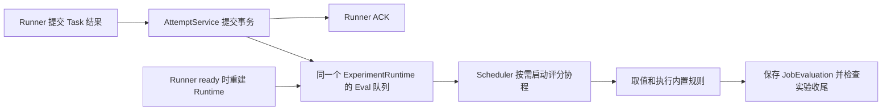

# 云端评分链路

`Scheduler` 管理 Task 派发和按需启动的评分协程。评分使用实验创建时保存的 `evaluators` 快照，以及该次实验固定的样本修订。 [Scheduler](../evalforge/server/scheduler.py) · [评分服务](../evalforge/server/services/evaluations.py)

## 发现待办与恢复

- 有效 Job 更新为 `succeeded` 并提交后，Attempt 服务查询并构造完整的 `EvaluationWorkItem`。会话把这些工作项交给 Scheduler，加入同一实验的 Eval 队列。ACK 不等待评分执行。
- 待办由数据库推导。查询成功的 Job，展开实验快照中的指标名，排除已经存在 `JobEvaluation` 的项（物理唯一键为 `(experiment_run_id, name)`），把缺项构造成 `EvaluationWorkItem`。取消中的实验和已取消实验跳过。
- 进程启动不查缺项。Runner 完成对账并进入 `ready` 后，持有会话的实例重建该 Runner 的实验 Runtime，同时加载缺失评分。Runner 不重连，缺项暂留数据库。
- 在途评分在单进程内去重，已启动的评分不受会话关闭影响。跨实例切换时可能重新计算尚未保存的评分，数据库唯一约束保留首次提交的结果。

## 执行、保存与收尾

- `input`、`reference`、`metadata` 来自固定的样本修订，`output` 来自 Job 的 `task_output`。路径语法和配置保存共用，支持点字段与非负数组下标。
- 内置规则在事件循环之外运行。正则与编辑距离使用可终止的子进程，计算设有 30 秒超时，超时或服务关闭时会终止子进程。
- 正常低分照常保存。配置、取值或规则执行错误记录在 `error`，也算该评分项已处理。数据库写入失败由 Scheduler 记录，缺项留给下一次 Runner `ready` 恢复。
- 保存评分时先锁 Job，再锁 Experiment，并检查取消状态。正常完成要等 Task 和 Eval 都收尾。取消沿用 Task 收尾规则，已提交评分保留。已收尾的 `unknown` Job 迟到补报成功时也可补评，实验仍保持 `completed`。

**TODO**　限制 Eval 并发和模型请求速率，防止大量完成结果或重连补评同时消耗 CPU、子进程和数据库连接；跨实例评分项领取。
