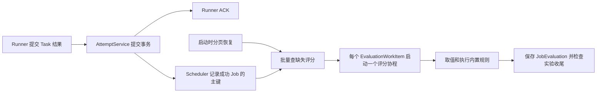

# 云端评分链路

`Scheduler` 管理 Task 派发和按需启动的评分协程。评分使用实验创建时保存的 `evaluators` 快照，以及该次实验固定的样本修订。 [Scheduler](../evalforge/server/scheduler.py) · [评分服务](../evalforge/server/services/evaluations.py)

## 发现待办与恢复

- 有效 Job 更新为 `succeeded` 并提交后，`AttemptService` 通知 Scheduler。Scheduler 合并 `job_pk`（`Job.id`，区别于协议里的 `job_id`），在主循环中 `await` 一次批量查询。评分协程由 `asyncio.create_task()` 按缺项启动，Runner ACK 只依赖 Task 提交。
- 待办由数据库推导。查询成功的 Job，展开实验快照中的指标名，排除已经存在 `JobEvaluation` 的项（物理唯一键为 `(experiment_run_id, name)`），把缺项构造成 `EvaluationWorkItem`。取消中的实验和已取消实验跳过。
- 进程重启后，Scheduler 按 `(job_pk, name)` 游标分页查缺项，再走同一个启动入口。Task 提交后丢失的内存通知可被恢复。评分算完但尚未提交时，重启后可能重新计算。
- 在途表在单进程内去重。结果表的唯一约束保留首次提交的评分。多实例的启动恢复可能同时算到同一项，跨实例执行领取留作 TODO。

## 执行、保存与收尾

- `input`、`reference`、`metadata` 来自固定的样本修订，`output` 来自 Job 的 `task_output`。路径语法和配置保存共用，支持点字段与非负数组下标。
- 内置规则在事件循环之外运行。正则与编辑距离使用可终止的子进程，计算设有 30 秒超时，超时或服务关闭时会终止子进程。
- 正常低分照常保存。配置、取值或规则执行错误记录在 `error`，也算该评分项已处理。数据库写入失败由 Scheduler 记录，缺项保留在数据库中，可由下次启动恢复。
- 保存评分的事务先锁 Job，再锁 Experiment，并检查取消状态。实验正常完成要等 Task 全部收尾，以及成功 Task 的评分都已保存。取消沿用 Task 收尾规则，已提交评分保留。有效的 `unknown` 迟到成功结果可补评，已经 `completed` 的实验保持该状态。

**TODO**　评分调度并发上限、模型请求限流、跨实例评分项领取。
