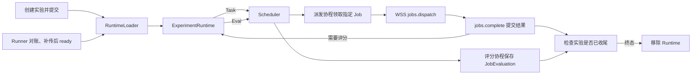

# ExperimentRuntime：实验在内存中怎么运行

每个未结束的实验对应一个 `ExperimentRuntime`。它归持有 Runner 会话的云端进程管理，数据库保存实际状态和结果。

| Runtime 成员 | 用途 |
| --- | --- |
| 执行配置、评分快照 | 实验创建时固定，整个实验共用 |
| Task 队列 | `JobWorkItem` 包含 Job 主键、协议 ID、样本 ID 和固定输入 |
| Task 派发 `inflight` | 从启动派发到接单回执收尾，记录正在派发的 Job；Runner 执行容量另由活跃 Attempt 占用 |
| Eval 队列 | `EvaluationWorkItem` 包含评分快照和输入上下文，评分协程取出后可独立运行 |

- **加载和接管**：云端启动时只初始化服务。创建提交后加载该实验；Runner `ready` 后，当前会话所在实例按 Runner 重建未结束的实验，一次填满两个队列。只剩评分或仍有 Attempt 运行的实验也加载。没有全局扫描、跨实例通知或分批补货。
- **调度**：Scheduler 只消费内存中的 Runner 和 Eval 就绪索引。派发协程负责查库、创建 Attempt、校验当前会话和发 RPC；明确可重试的拒绝在数据库恢复 `queued` 后回队。取消有独立触发入口。
- **释放**：正常运行时，实验进入数据库终态才移除 Runtime。旧会话失效时，旧实例清理自己持有的 Runtime；已经启动的评分可继续写库。未执行的待办由新会话从数据库找回。

[Runtime](../evalforge/server/experiment_runtime.py) · [加载器](../evalforge/server/services/runtime_loader.py) · [Scheduler](../evalforge/server/scheduler.py) · [改造计划](ExperimentRuntime改造计划（临时）.md)
