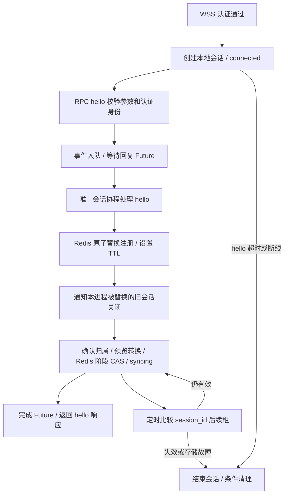

# Runner 会话管理基础

已实现 hello、单消费者会话事件、Redis 注册与租约、新连接接管、有效性检查和退出清理。Job 执行与会话分离，本阶段不处理 sync、ready 或任务业务。

## 对象与职责

| 文件 / 对象 | 作用 |
| --- | --- |
| `evalforge/server/runner_sessions.py` / RunnerSession | 每条连接一个对象和管理协程；处理 hello、续租、关闭，统一修改阶段。 |
| 同文件 / RunnerSessionManager | 进程内按 session_id 保存会话，生成本次进程实例 ID，统一关停。 |
| `evalforge/server/session_state_machine.py` | 共享阶段枚举、转换规则、guard、事件预检查与纯预览；会话通过 `_transition()` 统一提交阶段。 |
| `evalforge/server/runner_connections.py` | Redis 原子替换、比较有效性、续租与条件删除；保留 Runner API 的批量快照读取。 |
| `evalforge/server/routes/runner_ws.py` | 绑定认证身份和 RPC，监督会话、接收与授权监控任务。 |
| `evalforge/server/app.py` | 创建共享组件，关停时先清理会话，再释放存储资源。 |

## 核心流程

- 一个管理协程修改 phase，无会话状态锁；RPC 接收循环独立运行。
- phase 使用状态机的 SessionState，属性只读。hello 和续租先预检查事件，确认外部事实后交给 `_transition()`；退出通过 CLOSE，业务函数不直接赋值目标阶段。
- hello 先以 connected 注册，预览通过后比较 session_id 和预期阶段，更新 Redis 成功才提交本地 syncing。比较失败、超时或写入后停止都不返回成功；关闭继续走状态机。
- 有界队列承载 hello 事件。租约检查由管理循环的定时分支执行，不另建每会话续租任务。
- 停止通过 Future 发出信号；关闭时结束当前及排队的回复等待，并移除本地注册。
- hello 只允许成功一次；身份不一致、非法能力或容量、未知字段返回 -32602，重复 hello 返回 -32001。
- 当前仅支持 max_concurrent_jobs=1；capabilities 允许空列表，版本字段暂只做格式和长度校验，不做兼容性协商。

## Redis 与接管

键：`evalforge:runner:session:<runner_id>`。记录包含 session_id、cloud_instance_id、用户与凭据 ID、phase、客户端版本、能力、容量及连接时间；不含 Token 明文。

- 合法 hello 使用单次 SET GET EX 原子替换，返回旧 session_id。本进程立即通知对应旧对象关闭，避免迟到的注册响应误关闭更新连接。
- 跨实例旧会话通过消息前的有效性检查、空闲授权监控或续租发现失效。
- 读取有效性和续租要求注册具有有效 TTL；续租不创建缺失键。比较与操作在 Lua 中原子执行。
- 阶段更新额外比较预期阶段，使用 SET XX KEEPTTL，不延长租约或复活过期键；保留注册快照中的身份和能力。
- 正常关闭仅删除仍匹配自身 session_id 的注册，旧连接清理不影响新连接。
- 注册成功但响应丢失时仍尝试条件清理；存储不可用时由 TTL 兜底，不自动重放注册。
- 接管 / 租约失效 / hello 超时关闭 1008；存储故障关闭 1011；服务正常关停关闭 1001。
- 接管只使旧连接失效，不证明旧客户端上的 Agent 停止；Job 和 Attempt 的判断留给后续同步业务。

## 配置

| 环境变量 | 默认值 | 含义 |
| --- | --- | --- |
| EVALFORGE_RUNNER_HELLO_TIMEOUT_SECONDS | 10 | 连接建立后完成 hello 的期限，错误 hello 不延长期限。 |
| EVALFORGE_RUNNER_SESSION_TTL_SECONDS | 60 | Redis 会话租约秒数，正整数。 |
| EVALFORGE_RUNNER_SESSION_RENEW_SECONDS | 20 | 续租间隔。 |
| EVALFORGE_RUNNER_SESSION_OPERATION_TIMEOUT_SECONDS | 5 | 单次会话存储操作或 Attempt 业务操作的超时。 |
| EVALFORGE_RUNNER_SESSION_QUEUE_SIZE | 32 | 会话事件队列容量，正整数。 |

所有时间必须有限且为正；续租间隔加操作超时必须小于 TTL。监控、调度及存储延迟仍会影响实际失效检测时间。

## 兼容与下一步

hello 响应仍为 `{"session_id":"...","status":"ready"}`，兼容现有 Client 的解析约定；其中 ready 只表示握手通过。Redis 和服务端本地真实阶段为 syncing，Runner API 显示 online=true、phase=syncing。

服务端已注册 runner.sync、runner.ready、jobs.started 和 jobs.complete，客户端同步后显式确认 ready。数据库提交后才返回结果 ACK，详见 [Attempt 业务与同步](server-attempts.md)。

会话事件仍由唯一管理协程处理；AttemptService 管理业务短事务。任务创建、调度与 AttemptWorker 留待后续实现。

## 验证

单元测试覆盖空闲续租、过期不复活、本地与跨实例接管、注册响应丢失、三连接返回交错、队列容量、存储故障和关停。WSS 测试使用真实本机 TLS 连接，验证 hello、Runner API 状态、接管关闭、过期关闭和服务退出。

数据库使用测试 SQLite，Redis 使用 fakeredis；不代替真实 PostgreSQL / Redis 联调。

2026-11-05：状态机接入后云端全量 181 项测试，179 项通过，2 项因未配置真实 PostgreSQL / Redis 实例跳过；其中会话测试 23 项、状态机测试 19 项、真实 TLS/WSS 测试 17 项。移除 session_id 比较或让 hello guard 拒绝合法握手，实际会话测试均捕获变异，源码已恢复。编译和文档检查通过，独立代码复查未发现必须修复的问题。

相关：[状态机](server-state-machine.md)、[WSS 基础](server-wss.md)、[协议草案](EvalForge_Runner_JSON-RPC_Protocol_v1.md)、[架构讨论](云端运行架构.md)。
