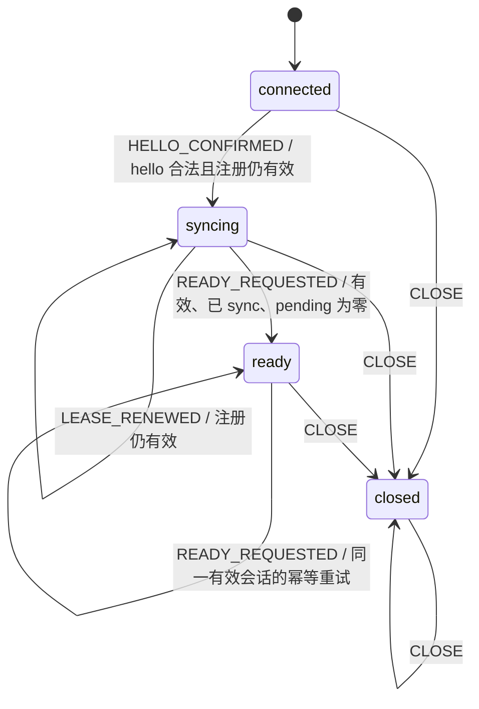

# 云端会话状态机

规则模块：`evalforge/server/session_state_machine.py`。已接入 RunnerSession 的 hello、续租和关闭；规则仍为纯函数，不读写存储。sync / ready 业务与 Experiment、Job、Attempt 的完整状态机后续实现。

## 结构

| 元件 | 含义 |
| --- | --- |
| SessionState | connected、syncing、ready、closed 四个阶段。 |
| SessionEvent | hello 确认、ready 请求、续租确认、关闭。 |
| SessionContext | 本次判断所需的可信事实：有效会话、hello 校验、sync 是否处理、历史待补传数量。 |
| SESSION_TRANSITIONS | `(当前状态, 事件): (guard, 目标状态)` 只读规则表。 |
| validate_session_event() | 外部操作前检查当前阶段是否允许该事件；成功返回 None，拒绝抛异常，不执行 guard。 |
| preview_session_transition() | 查规则、执行 guard，返回只读预览：allowed、next_state、reason。 |
| next_session_state() | 复用预览的严格入口：成功返回目标状态，拒绝则抛出异常。 |
| TransitionRejected | 拒绝原因：unsupported_transition 或 guard_rejected。 |



## 规则

| 当前阶段 | 事件 | guard | 目标阶段 |
| --- | --- | --- | --- |
| connected | HELLO_CONFIRMED | hello_validated 且 is_current | syncing |
| syncing | READY_REQUESTED | is_current、sync_processed 且 pending_uploads_count=0 | ready |
| ready | READY_REQUESTED | is_current | ready |
| syncing / ready | LEASE_RENEWED | is_current | 原阶段 |
| 任意阶段 | CLOSE | 无额外条件 | closed |

- 未列出的转换一律拒绝，包括重复 hello、同步前 ready、closed 重新打开。
- sync 和结果入库可以只改变上下文，不需要额外阶段；pending 只统计本次快照中的历史结果。
- ready 表示会话已准备好，不表示 Runner 空闲；Job 容量另行判断。
- 失效、接管、断开、超时、关停统一触发 CLOSE，关闭原因和协议关闭码由外层保存。
- 关闭不依赖有效租约，否则失效会话将无法完成本地清理。

## 调用示例

```python
from evalforge.server.session_state_machine import (
    SessionContext, SessionEvent, SessionState, preview_session_transition,
)

context = SessionContext(
    is_current=True,
    sync_processed=True,
    pending_uploads_count=0,
)
preview = preview_session_transition(
    SessionState.SYNCING, SessionEvent.READY_REQUESTED, context,
)
assert preview.allowed
assert preview.next_state == SessionState.READY
# 当前状态仍是 syncing；预览不提交转换。
```

guard 不通过时返回 allowed=False、next_state=None、reason="guard_rejected"；没有对应规则时 reason="unsupported_transition"。参数类型错误仍抛出 TypeError。guard 来自规则表，调用方传入上下文，不自行覆盖 guard 结果。

调用方检查 `preview.allowed`，不要用 `if preview` 判断是否允许；预览对象存在不代表转换通过。

## RunnerSession 接入顺序

1. hello：先用 validate_session_event() 拒绝错误阶段，再以 connected 注册；确认当前会话后，预览 HELLO_CONFIRMED，Redis 比较当前阶段并更新为预览目标，成功后更新本地阶段并响应。
2. ready：根据 sync_processed 和历史 pending_uploads 计算目标阶段；复用同一转换入口，在 Redis 原子更新成功后再更新本地阶段、返回 ACK。
3. 续租：心跳用 LEASE_RENEWED 校验续租结果，不修改会话阶段；失败时通知管理协程走 CLOSE。
4. 关闭：通过 CLOSE 进入本地终态，再按 session_id 条件清理 Redis；不在 Redis 长期保存 closed。

context 只能由云端构建，不能直接相信客户端提交的布尔值。预览只对当前快照有效，不是预约或锁；is_current 是瞬时校验结果，外部操作仍须原子比较，提交时上下文变化需要重新判断。规则函数不提供锁、事务、TTL 或身份认证。

当前阶段由会话对象持有，状态机只计算目标，避免引入第二份可变阶段。RunnerSession.phase 只读，除初始化外仅 `_transition()` 根据预览提交阶段；超时策略仍可读取阶段，不自行决定转换目标。转换被拒绝不提交目标，运行异常可触发 CLOSE；存储写入结果不确定时结束会话并重新同步。

Redis 阶段提交比较 session_id、预期阶段和有效 TTL，使用 SET XX KEEPTTL 保留租约；登记快照由 Python 序列化，保留空 capabilities 数组。CLOSE 只提交本地终态，随后条件清理 Redis。

## 验证

状态机测试覆盖完整路径、非法转换、guard、终态、幂等、上下文类型、预检查与只读预览；会话测试验证状态机规则实际生效，以及 Redis 提交前后发生接管、阶段变化、停止和响应丢失的处理。验证结果见 [会话管理基础](server-sessions.md)。

相关：[会话管理基础](server-sessions.md)、[云端运行架构](云端运行架构.md)。
