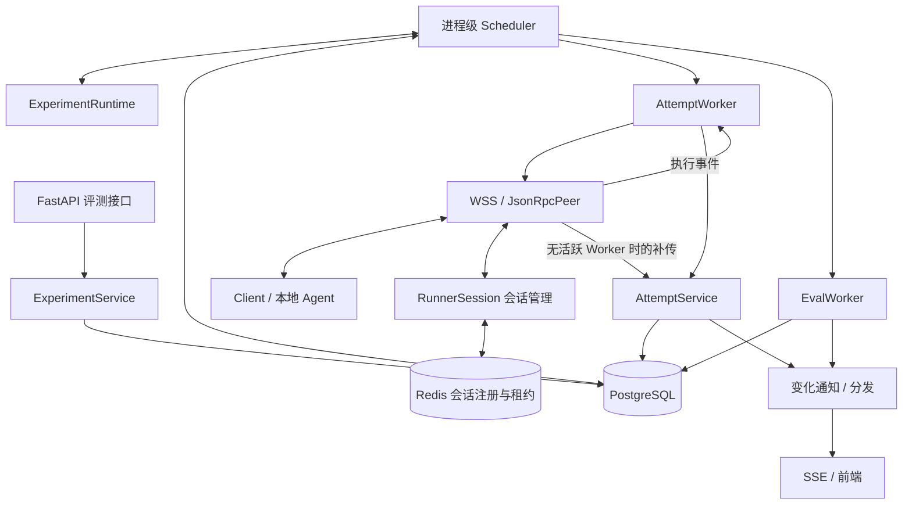
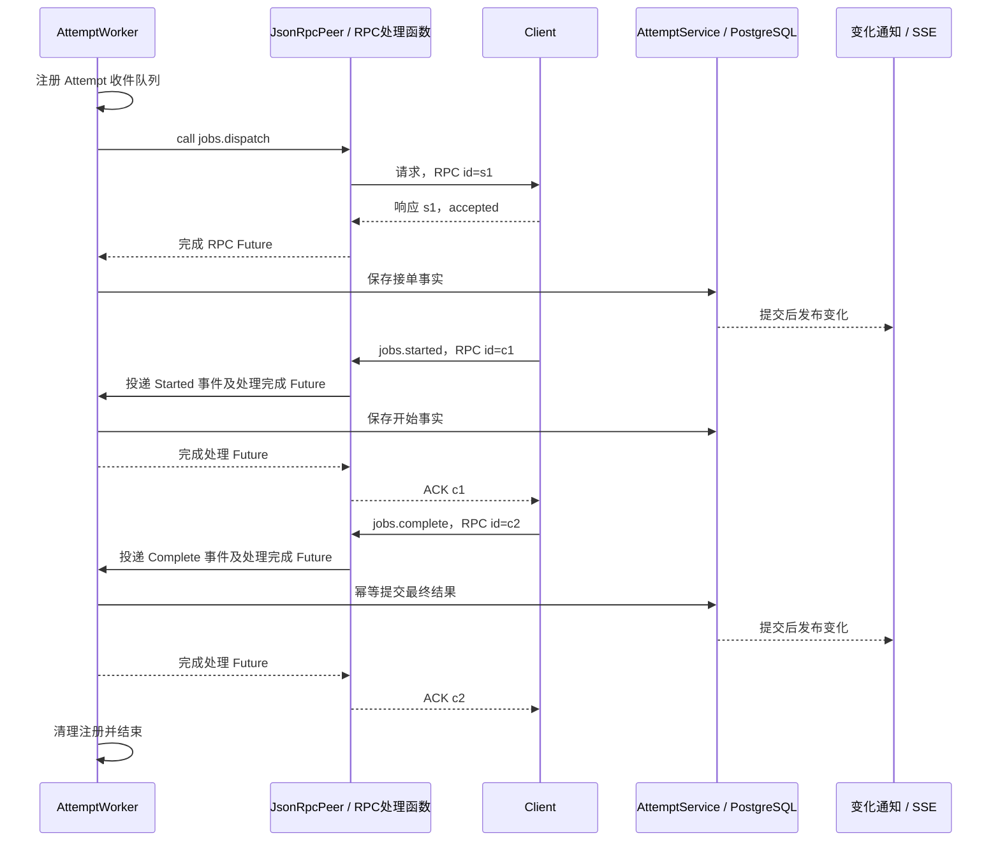
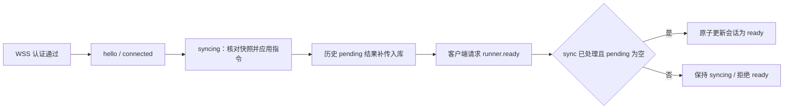

# EvalForge 云端运行架构

> 讨论稿，2026-11-05。记录本阶段的架构约定，不代表全部功能已经实现。

当前已实现的对象和数据流请先看 [当前项目架构图解](当前项目架构图解.md)。本文中的 Scheduler、ExperimentRuntime、AttemptWorker、EvalWorker 和 SSE 等仍包含规划内容。

## 1. 范围与原则

- Cloud 管理实验、调度、评分和结果；Client 调用本地 Agent HTTP API。
- 用户通过 HTTP 创建评测；Cloud 与 Client 通过 WSS + JSON-RPC 双向通信；前端通过 SSE 接收变化。
- 一个 Runner 同时执行一个 Task Attempt，排队任务留在云端。
- 连接管理与 Job 业务分开；连接断开不等于执行失败。
- PostgreSQL 保存业务事实，内存对象可以重建；先实现核心闭环，不预设完整分布式任务框架。

## 2. 整体结构

图中执行事件经过已注册的 RPC 处理函数路由；SSE 是展示通道，不参与结果确认。

## 3. 关键对象

| 对象 | 职责与生命周期 |
| --- | --- |
| Experiment | 一次评测的持久记录：数据集版本、样本快照、执行配置、整体状态。 |
| ExperimentRuntime | 本进程中的实验运行视图：配置、Task / Eval 待办缓冲、执行关联、扫描位置与进度；普通内存对象，不要求专属常驻协程。 |
| Job / ExperimentRun | 一条样本的一次逻辑执行；通过 job_id 标识，同一 Job 可有多个 Attempt。现有 ORM 的执行状态表达 Task 结果，评分进度单独处理。 |
| RunnerAttempt | 一次实际分配与执行：attempt_id、Runner 归属、派发快照、状态、取消意图和最终结果。 |
| Scheduler | 每个云端进程一个后台调度循环，选择工作、匹配资源、启动执行任务。 |
| RunnerSession | 每个有效连接一个会话对象及管理协程，维护身份、连接阶段、同步上下文、租约与关闭。 |
| JsonRpcPeer | 每条连接一个；负责接收分流、方法注册、RPC Future、超时和断线处理。 |
| AttemptWorker | 每个活跃 Attempt 的临时业务消费者；下发请求，顺序处理接单、开始和完成事件，调用业务服务入库。 |
| AttemptService | 集中实现归属校验、状态转换、事务和幂等；不依赖某个 Worker 或连接始终存在。 |
| EvalWorker | 执行一项评分工作，读取样本、参考答案和 Task 输出，保存评分；运行在云端。 |

ExperimentRuntime 不绑定某条 WSS 连接。RunnerSession 不负责整个 Experiment 的执行与评分。

## 4. 调度与执行生命周期

1. API 校验用户归属，创建 Experiment、样本快照和 queued Jobs；提交后返回 experiment_id。
2. Scheduler 从数据库补充 Runtime 缓冲，寻找本实例持有的 ready Runner。
3. 事务内领取 Job、创建 Attempt，提交后启动 AttemptWorker；不持有数据库事务等待网络。
4. Client 确认接单、开始调用 Agent，随后提交结果。Worker 通过 AttemptService 推进状态。
5. Task 终态入库后释放 Runner 容量；成功输出按配置产生待评分工作。
6. Scheduler 在云端评分容量内启动 EvalWorker；评分结果入库后重新检查实验进度。
7. 所有 Task 与评分工作均已结束，实验完成。评分为 0 分不等于执行失败。

两类资源独立计算：Task 占 Runner 容量，Eval 占云端评分容量。上一条样本评分时，Runner 可以执行下一条。

调度器只安排工作，远程等待由独立任务承担。新实验、ready、结果入库和容量释放可唤醒调度器，定期扫描兜底。

## 5. 消息接收与 Attempt 事件

### 标识与分流

- RPC id：一次请求与响应；一个 RPC 只返回一次。
- job_id：逻辑任务；attempt_id：本次执行尝试。
- `_receive()` 是每条连接唯一的网络读取协程。
- 收到响应：按 RPC id 完成 `_pending` 中的 Future，唤醒 `peer.call()`。
- 收到请求：按 method 调用注册函数；started / complete 按 attempt_id 路由到 Worker 队列。
- Worker 的业务事件队列接收多条事件，RPC Future 只等待单次响应。

### 处理约束

- 发送 dispatch 前注册收件队列，避免快速执行产生的事件无处接收。
- started / complete 可早于接单响应被业务处理；事件先入队，状态规则允许交错，终态不倒退。
- 入队成功不返回结果 ACK。RPC 处理函数等待处理完成 Future，数据库提交成功后才确认。
- Worker 不存在时，由 RPC 入口调用同一 AttemptService 处理补传；不得丢弃结果或伪造 ACK。
- 明确拒绝可按规则重新排队；下发超时、断线只说明结果不确定，不立即生成新 Attempt 重执行。
- 重复事件幂等；同一 Attempt 的冲突终态结果不直接覆盖。
- 网络断开时结束相应等待并清理资源，业务状态依据数据库和后续 sync 确认。

## 6. 会话管理与同步

RunnerSession 使用有界事件队列，由唯一管理协程修改 phase、closed、sync_processed、pending_uploads 等会话字段。其他协程只投递事件；不在管理协程中等待整次 Agent 执行。

- hello 只确认握手；已通过显式 runner.ready 确认同步结束，协议和客户端同步更新，见 [Attempt 业务与同步](server-attempts.md)。
- pending_uploads 是本次 sync 历史待确认结果的集合，放在会话内存；结果入库后移除。重连重新构建。
- sync 期间允许提交已有 Attempt 的结果；快照之后产生的新结果不必阻止 ready，可在 ready 后正常上报。
- 同步指令由业务服务根据数据库生成；会话管理器只维护同步进度。ready 不表示 Runner 空闲。
- 单一写入协程避免本地会话状态锁；Redis 注册、续租、阶段更新和清理仍须原子比较 session_id。
- 关闭时结束管理循环并清理资源；旧连接不得删除或覆盖新连接注册。

## 7. 存储、多用户与多实例

| 位置 | 内容 |
| --- | --- |
| PostgreSQL | 实验、样本快照、排队 Job、Attempt、取消意图、Task 结果和评分。 |
| Redis | 当前有效 session_id、cloud_instance_id、连接阶段、身份关联及 TTL 租约。 |
| 进程内存 | Runtime 缓冲、Socket / Peer、会话事件队列、Attempt 收件队列、Future、同步上下文。 |

Redis 注册键沿用 `evalforge:runner:session:<runner_id>`；实例 ID 区分进程和重启。租约失效或被接管后，旧连接停止有效操作。

- 用户归属来自认证身份和数据库：Job → Experiment → User，Attempt → Runner → User。
- 调度按实验用户和配置筛选 Runner；接收结果校验连接身份与 Attempt / Job 绑定，不信任客户端自报 user_id。
- 各实例优先为自己持有有效连接的 Runner 领取 Task；数据库原子领取及约束防止重复占用。
- Runtime 是本进程视图，不要求整个 Experiment 永远归属一条连接或一个实例。
- unknown Attempt 保留在历史中并释放 Runner 容量。租约和 Ping/Pong 只能反映连接状态，远端 Agent 仍可能在执行。
- Redis 比较更新不替代 PostgreSQL 事务；跨实例写入隔离需在业务实现中具体落实。

## 8. 前端通知与资源边界

- 数据库提交后发布变化；前端可展示等待、已接单、执行中、等待评分、评分中和终态。
- 执行中表示客户端已开始调用 Agent，不代表已获知 Agent 内部进度。
- SSE 按用户权限订阅实验；多个页面需要广播，每个连接使用独立有界发送缓冲，不能竞争消费同一个普通队列。
- 慢前端不阻塞业务入库或 Client ACK；重连先读取数据库快照，再接收变化。
- 单实例可使用进程内通知；跨实例通知的选型待定。若要求历史事件可靠重放，再设计持久化事件流 / Outbox。
- 只为活跃 Attempt 创建 Worker，排队 Job 不创建协程；结束后移除队列、Future 和任务引用。
- 连接数、消息缓冲、下发并发、Eval 并发分别限制；协程数量不等于 CPU 并行度，容量通过压测确定。

## 9. 当前状态与后续决策

- 已有基础：鉴权、Runner 管理、PostgreSQL / Redis 连接设施、核心 ORM、WSS 与双向 RPC；RunnerSession 已实现 hello、租约、接管和关闭，参见 [会话管理基础](server-sessions.md)。Client 已有执行、取消、持久化及重连同步能力。
- 当前 Task 与 Eval 链路见 [项目架构图解](当前项目架构图解.md) 和 [云端评分链路](server-evaluations.md)。Scheduler 直接从数据库发现评分缺项，ExperimentRuntime 保留为独立类。SSE 留待后续接入。
- 待细化：Eval 工作持久化、完整状态转换表、Worker 超时与退出规则、跨实例写入隔离、前端通知传输与恢复、用户公平性和配额。
- 实施顺序：会话同步闭环 → 单 Runner 的 Task 执行闭环 → 取消与恢复 → Eval 与前端通知。

## 10. 相关资料

- [WSS 与 RPC 当前实现](server-wss.md)
- [Cloud ↔ Runner 协议草案](EvalForge_Runner_JSON-RPC_Protocol_v1.md)
- [Client 会话层](client/会话层核心链路.md)
- [核心 ORM](orm.md)
- Phoenix 参考：`src/phoenix/server/daemons/experiment_runner.py` 中的 ExperimentRunner、RunningExperiment、TaskWorkItem、EvalWorkItem。
