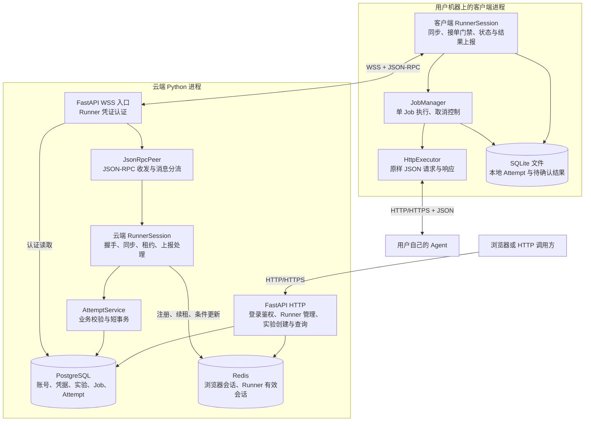
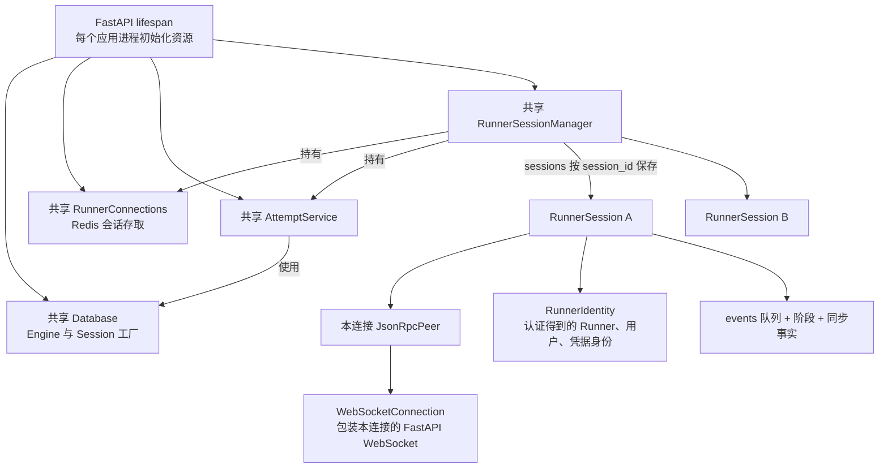
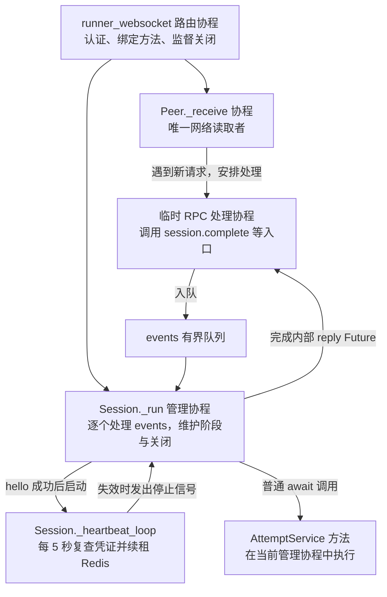
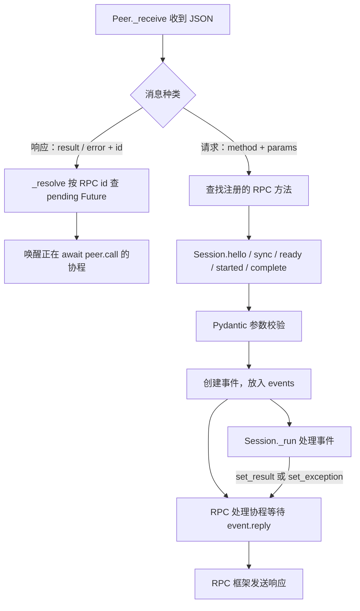
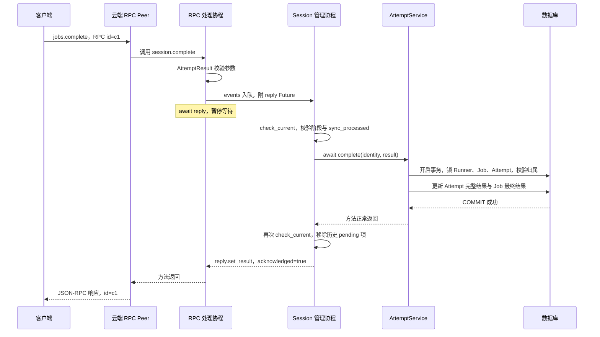
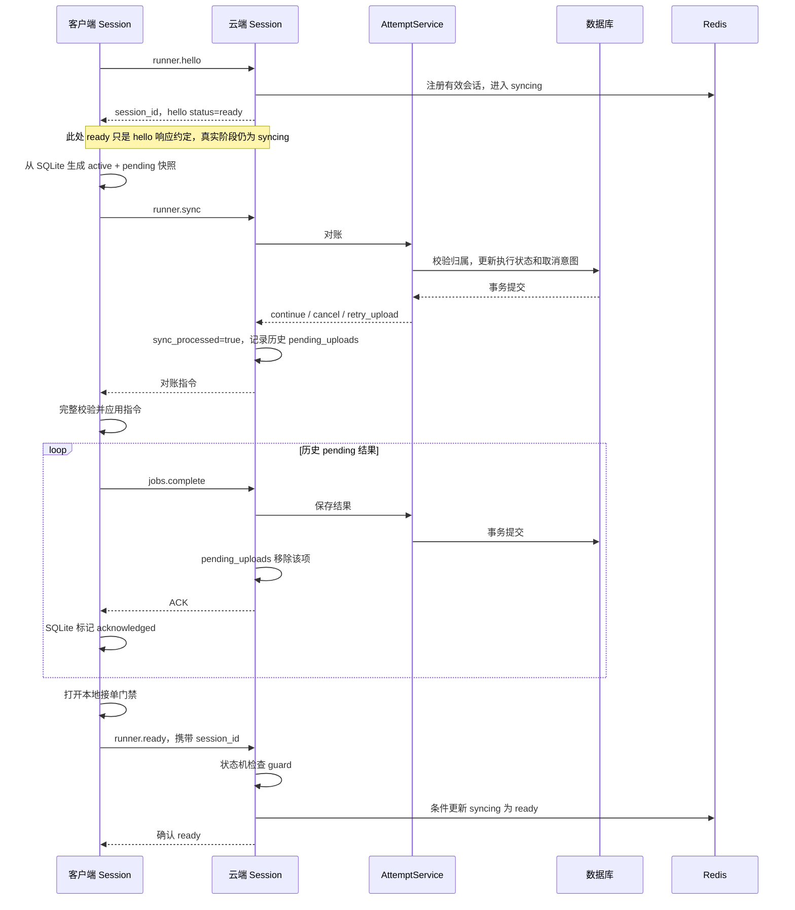
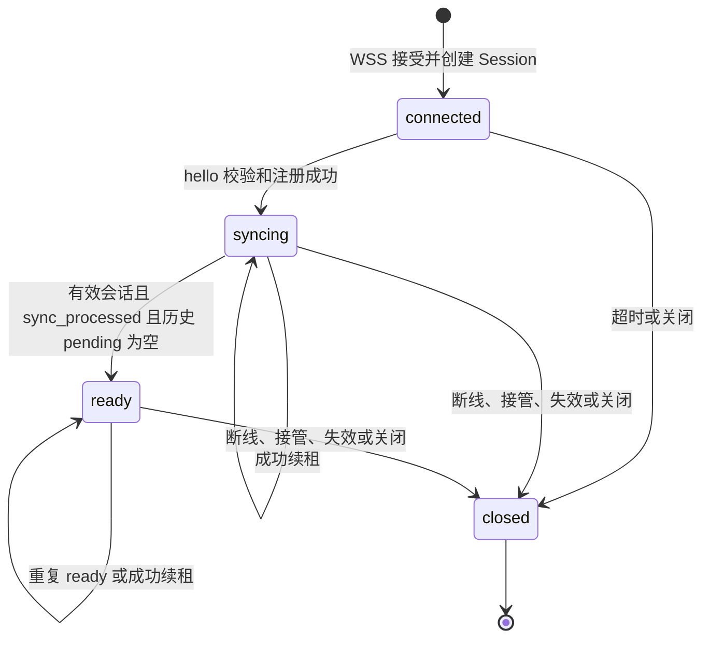
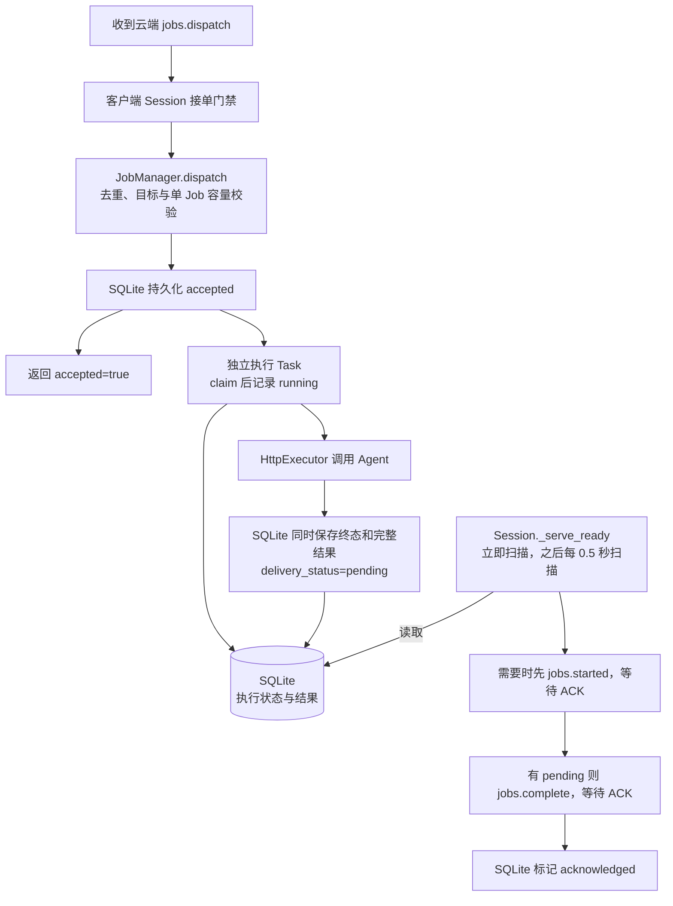
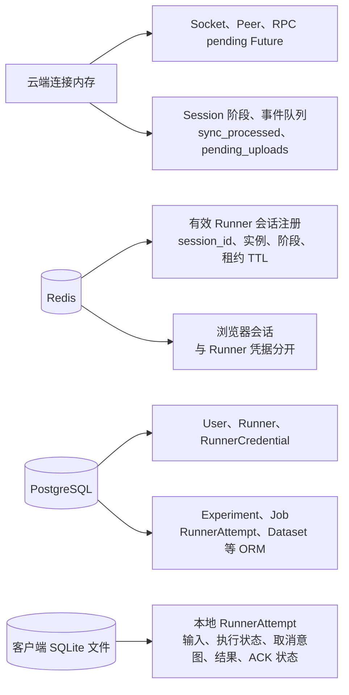
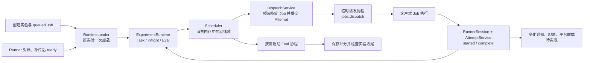

# EvalForge 当前项目架构图解

> 按 2026-11-08 当前源码整理。先看图 1、4、5，再看同步和恢复。本文展示已实现结构；未来设计集中放在最后。

## 1. 组件全景：云端、客户端、Agent

- 图中的浏览器仅表示 HTTP 调用方；当前没有平台前端页面。
- [实验创建与查询](api/实验创建与查询.md)、WSS 和客户端执行能力已实现。创建会固定样本快照并生成 queued Job，由云端进程级 Scheduler 自动派发。
- 客户端主动连接云端。Agent 的 URL、请求头在客户端配置，云端只传 `agent_target_id` 和 input。
- PostgreSQL、Redis 连接基础设施已实现；当前验证使用 SQLite / fakeredis 及本机网络，不表示已部署真实服务实例。

## 2. 对象关系：谁持有谁

以下箭头表示创建或引用，不表示启动协程。

| 对象 | 生命周期与作用 |
| --- | --- |
| RunnerSessionManager | 进程级对象，创建、索引、关闭会话，向 Scheduler 报告就绪、结果提交与关闭 |
| 云端 RunnerSession | 每条接受的连接一个，保存本轮连接的阶段与同步进度 |
| JsonRpcPeer / WebSocketConnection | 每条连接各自一份，负责 RPC 与传输 |
| AttemptService | 多个会话共享的业务对象，不自己启动后台循环 |
| SQLAlchemy AsyncSession | 每次业务短事务创建；与 RunnerSession 无关 |
| 会话状态机 | 纯规则函数；没有独立后台协程，不另存一份可变阶段 |

新连接建立时，旧连接可能尚未退出，因此同一 Runner 可短暂有两个 Session 对象；Redis 注册决定哪个有效。

## 3. 执行关系：哪些东西真的是协程

对象不等于协程。`AttemptService.complete()` 被 await 时，并不会因此自动创建一个新 Task。

管理协程会等待有时限的数据库操作，但不等待 Agent 整次执行。心跳和 RPC 网络读取各自运行；WSS 文本收发不逐条查库。

`Session._run()` 等待队列事件、`_stop` 或 hello 超时。注册后由心跳协程计时，业务消息不会推迟续租。

## 4. 消息分流：RPC 响应与业务请求走不同路径

| 两种 Future | 由谁完成 | 解决什么问题 |
| --- | --- | --- |
| RPC pending Future | Peer._resolve | 把远程响应交给对应的 peer.call 调用者 |
| 事件 reply Future | Session._run | 把管理协程处理结果交回 RPC 处理协程 |

Future 是一次性结果容器；`await` 它的协程才是等待者。`events` 是会话事件队列，不是云端 Job 排队队列。

`jobs.dispatch` 的 accepted 是 Scheduler 发起的请求的响应。`jobs.started`、`jobs.complete` 是 Runner 发起的独立请求，各有自己的 RPC id，由 RunnerSession 分别处理。

## 5. 保存一次结果：完整调用链

- 已有相同终态结果：检查后幂等确认；不同结果：拒绝覆盖。结果比较区分 JSON 布尔值与数字。
- 数据库异常：事务回滚 → RPC 业务入口记录一次脱敏 ERROR → 返回 RPC error；不返回成功 ACK，不做云端自动重试。
- Redis 会话失效、被接管或阶段提交结果不确定：关闭连接。Redis 与 PostgreSQL 不属于同一事务；在途事务可能已经提交，新会话据数据库事实重新对账。

## 6. hello → sync → 补传 → ready

`sync_processed=true` 表示同步快照已完成对账，不表示结果全部保存。进入 ready 还要求有效会话且历史 `pending_uploads` 为空。

| sync 发现的情况 | 处理 |
| --- | --- |
| 本地 accepted / running，允许继续 | 更新已知状态，返回 continue |
| 有取消意图，或实验正在取消 | 返回 cancel；不直接伪造 cancelled 终态 |
| 已跳过的 Attempt 再次出现在活跃快照 | 返回 cancel，保留 unknown，最终结果仍可补传 |
| 历史 pending result | 返回 retry_upload，最终保存统一走 complete |
| 云端活跃 Attempt 在快照中缺失 | 标记 unknown，释放容量并跳过该 Job |

历史 pending 才阻塞 ready。快照后新生成的结果可以后续正常上传；active Job 不必结束，但仍占用执行容量。

## 7. 三套状态：不要混在一起理解

| 状态属于谁 | 示例 | 表达的事实 |
| --- | --- | --- |
| 云端会话阶段 | connected / syncing / ready / closed | 本轮连接能否正常参与业务 |
| Attempt 执行状态 | assigned / accepted / running / unknown / succeeded / failed / cancelled / rejected | 一次派发尝试发生了什么；完整迁移规则由业务方法校验 |
| 客户端结果投递状态 | not_ready / pending / acknowledged | 是否已有结果，以及云端是否确认 |

例如“会话 ready、Attempt running、投递 not_ready”完全正常；“会话断开、Attempt succeeded、投递 pending”也正常。

会话 FSM 只计算允许的目标阶段；Session 执行 Redis 条件更新后才提交本地阶段。Job / Attempt 状态不是这套会话 FSM 管理的。

## 8. 客户端：执行和上报如何分开

- JobManager 保存结果，不直接负责 WSS 上报；Session 从 SQLite 发现变化。扫描是本地数据库读取，不是轮询云端。
- ACK 丢失、RPC 错误或连接断开：保留 pending，客户端现有连接循环会重连并对账，不因此重新调用 Agent。
- 网络重连保留进程级 JobManager。进程启动时将遗留 running 转为历史 unknown，Runner 可以接收后续 Job。
- accepted 回复与 HTTP 执行由不同协程推进，不保证网络上 accepted 一定早于所有执行状态变化。
- cancel 当前仅停止客户端 HTTP 等待，不调用 Agent 取消接口；远端 Agent 可能仍继续执行。

客户端 `run_client()` 共享 JobManager、AttemptRepository、ClientDatabase 和 HttpExecutor；每条新连接重新创建 Peer 和客户端 Session。

## 9. 数据放哪里，断线后什么还在

| 生命周期 | 保存什么 | 连接断开后的处理 |
| --- | --- | --- |
| 单连接内存 | Socket、Future、同步进度 | 关闭并重建；未完成调用结束或抛异常 |
| 云端进程内存 | Manager、共享服务、数据库连接池 | 连接断开不销毁整个进程资源 |
| Redis 有效注册 | `evalforge:runner:session:<runner_id>` | 正常关闭条件清理；进程异常退出依靠 TTL |
| PostgreSQL | 业务事实 | 保留，以事务提交结果为准 |
| 客户端 SQLite | 本地执行事实和未确认结果 | 保留，供重连或重启恢复 |

客户端与云端都有名为 RunnerSession 的类，也各有 RunnerAttempt 模型；它们是不同进程中的不同对象，不共享内存。客户端当前执行层使用 ClientDatabase ORM；较早的 store.py 是独立底层存储设施，不在默认 Job 执行链上。

## 10. 进程级调度

- 实验创建、会话 ready、结果提交只唤醒对应 Runner 或实验。云端启动不做全局扫描；断线后由新会话所在实例按 Runner 重建完整 Runtime。
- 每个 Runner 同时最多持有一个活跃 Attempt。Scheduler 从 Task 队列选中 Job，放入 `inflight`；派发协程在事务中领取指定 Job、创建 Attempt，再通过当前会话发 RPC。样本输入取自实验固定的修订。
- 派发协程只等接单回执。明确的 `busy` / `not_ready` 将 Job 放回队列并延迟重试。派发结果不确定时，仍为 assigned 的 Job 和 Attempt 转为 unknown，释放容量并等待重连对账。迟到回执保留 started 或 complete 已写入的状态。
- 首次领取时实验进入 running。成功结果提交后，评分工作项进入同一 Runtime 的 Eval 队列。正常完成等待 Task 收尾和预期评分落库，然后释放 Runtime。见 [云端评分链路](server-evaluations.md)。
- 取消实验时，HTTP 接口提交取消意图并结束排队 Job。Scheduler 优先下发已记录的取消指令，Runner 离线时由重连对账接续。最终结果提交后，已收尾的 cancelling 实验进入 cancelled。见 [实验取消接口](api/实验创建与查询.md#4-取消实验)。

完整生命周期见 [ExperimentRuntime](server-experiment-runtime.md)。

仓库也保留独立的离线 V0，由 `examples.run_pipeline` 或 `examples.run_demo` 启动本地 Runner，执行 Task 与 Evaluator 并生成 JSON 报告。

没有实现云端保存失败 Outbox 或自动重试。结果入库失败只记录异常并返回错误；数据库可能仍停留在此前的 running 等状态。

## 11. 按图定位代码

| 想看什么 | 源码 |
| --- | --- |
| 云端进程资源初始化 | [server/app.py](../evalforge/server/app.py) |
| WSS 鉴权、注册方法、监督连接 | [routes/runner_ws.py](../evalforge/server/routes/runner_ws.py) |
| RPC 接收分流、pending Future | [server/rpc.py](../evalforge/server/rpc.py) |
| Session 队列、事件 reply、sync / ready | [runner_sessions.py](../evalforge/server/runner_sessions.py) |
| 会话状态规则、Redis 注册与 CAS | [session_state_machine.py](../evalforge/server/session_state_machine.py)、[runner_connections.py](../evalforge/server/runner_connections.py) |
| 入参模型、业务事务 | [schemas/attempts.py](../evalforge/server/schemas/attempts.py)、[services/attempts.py](../evalforge/server/services/attempts.py) |
| 调度循环、领取和派发回执 | [scheduler.py](../evalforge/server/scheduler.py)、[services/dispatch.py](../evalforge/server/services/dispatch.py) |
| 客户端启动、连接循环 | [client/app.py](../client/evalforge_client/app.py)、[transport.py](../client/evalforge_client/transport.py) |
| 客户端同步、扫描、上传 | [client/session.py](../client/evalforge_client/session.py) |
| 单 Job 执行、HTTP 调用 | [job_manager.py](../client/evalforge_client/job_manager.py)、[http_executor.py](../client/evalforge_client/http_executor.py) |
| 客户端状态持久化 | [attempts.py](../client/evalforge_client/attempts.py)、[database.py](../client/evalforge_client/database.py) |
| 云端 Job / Attempt ORM | [experiments.py](../evalforge/db/orm/experiments.py)、[attempts.py](../evalforge/db/orm/attempts.py) |

继续阅读：[Attempt 业务与同步](server-attempts.md)、[客户端会话链路](client/会话层核心链路.md)、[通信协议](EvalForge_Runner_JSON-RPC_Protocol_v1.md)。[云端运行架构](云端运行架构.md)保留更完整的规划，不能把其中全部对象当作当前已实现对象。
